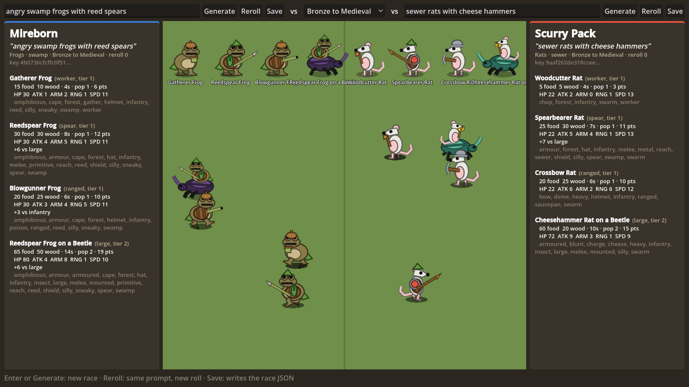
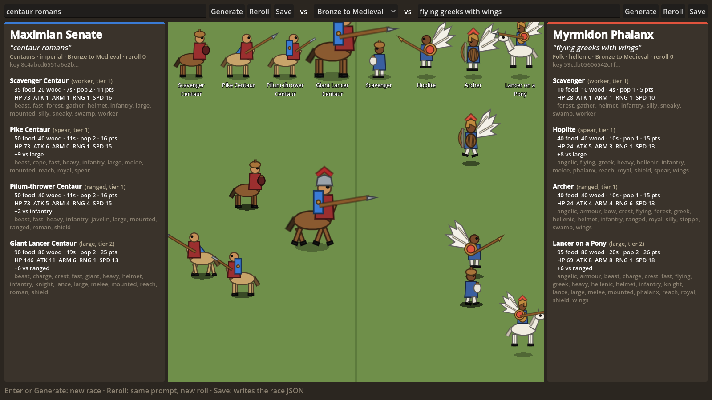
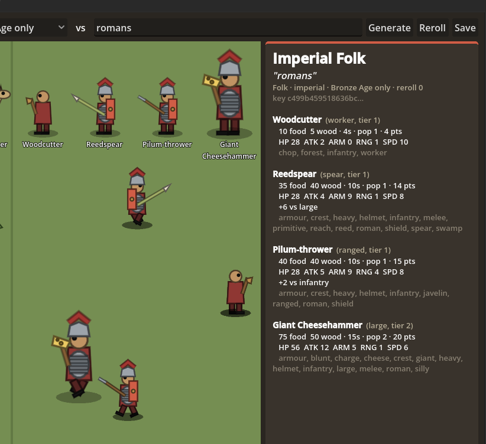
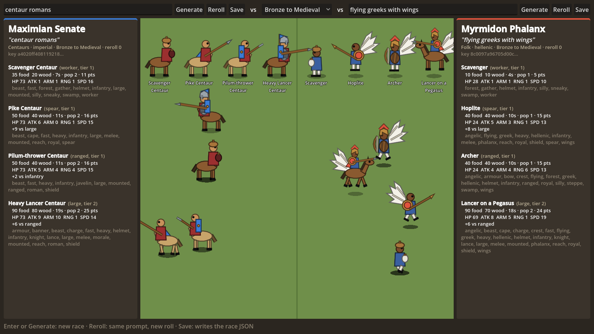

# 2026-10-10: From an industry chat to the Race Lab

**Milestone:** 0 (race generation): done
**Who:** Dominic + Claude (claude.ai, linked to the Mac)

## What happened

It started as a question about where game development is heading: season passes, the indie
resurgence, AAA struggling, RAM prices pushing the PS6 back, Unreal overtaking Unity and Godot
growing, and friendslop co-op topping Steam. That turned into "what would be a safe indie bet
for 2027" (small co-op with a P2P backend). Then, unrelated: *people love classic RTS games, they love
customising and making their own games. What about one that's super easy to mod, maybe
with AI generating the world?*

The idea sharpened quickly:
- AI at runtime -> seeds -> "the non-determinism is the fun" -> generation in game, shared as a
  hyperblob.
- Image generation -> **parts and tools**, Borderlands guns but for frogs.
- Small LLM + harness -> **no AI at runtime at all**; dev-time AI for breadth, simple NLP to play.
- "Unlimited" feels limited on specific requests (WW2 Americans on Mongolian ponies) -> honest
  substitutions, community parts, and the realisation that **bad results are the fun**.
- Balance through cost: a 10ft spider is allowed, it's just expensive.
- Host modes: curated, bounded (default: you don't know what you'll fight), no limits (later).

Research produced an MVP plan for a 10-minute Godot demo: deterministic lockstep sim, a
Hyperswarm sidecar later, flow fields, palette shader, Frogs vs Rats. Then we built
**milestone 0** first: the data contract, the generator, pricing, the composer and the Race Lab,
in `~/Dev/age-of-whatever`.

## Decisions
D-001 to D-018 in `../decisions.md`, all made today.

## Direction changes
- Folder name: frogs-vs-rats -> **age-of-whatever**.
- Research said cut the prompt generator from the MVP -> we built it first.
- Winged Greeks: pegasi -> **wings on their backs**, pulp sci-fi style. Pegasi stay as an option.
- Large units: always giant if no mount -> **Heavy** for humans/centaurs; giants for frogs,
  spiders and rats.
- Ranged: one slot -> **skirmisher + archer**, as the genre does it.
- How close to the classic RTS formula? -> the genre's standard role structure, with our own names, art and twists.

## Pictures

First render, Frogs vs Rats:

Second test, centaur Romans vs winged Greeks:

The bug: a giant Roman with a cheese hammer ("Bronze Age only", prompt "romans"):

After the fixes, the Heavy Lancer Centaur and a Lancer on a Pegasus:

## Funny moments and bugs worth remembering
- "flying greeks with wings": the word "greeks" didn't imply people, so **the Spiders
  volunteered**. Hellenic Spiders with hoplite spears.
- Sewer rats got **Hoplite Rats** (Greek spears leaking into everything) before culture gear was
  gated.
- **Giant Cheesehammer**, a Roman in Bronze Age only. Cheese won on "heavy" and "charge".
- Winged riders on wingless ponies: the rider hovered and the pony floated along under him.
- The WW2 note works first time: "No world wars yet. Issued saucepans for helmets."

## Ideas parked
- A space-fleet sci-fi mod (Dominic's dream).
- An LLM brief expander for cultural knowledge ("romans" -> legionaries, testudo).
- Lily-pad rafts and bottle boats for naval.
- Raccoons (apparently the animal of 2026).
