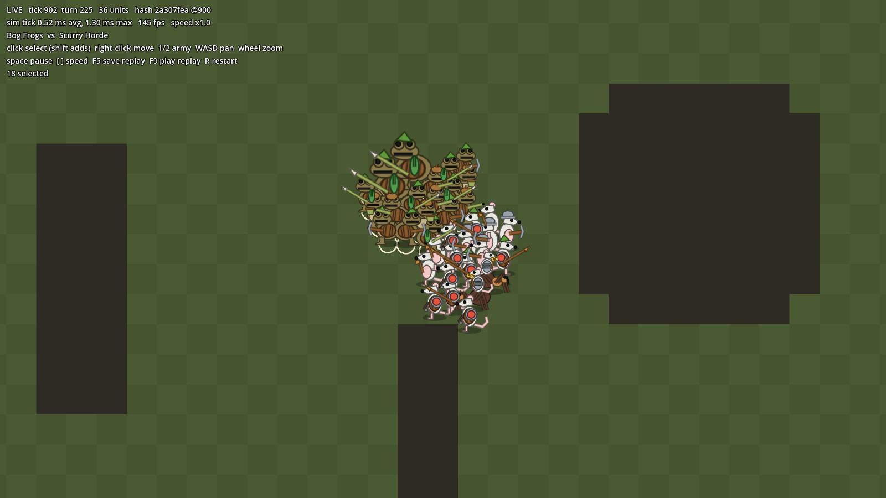
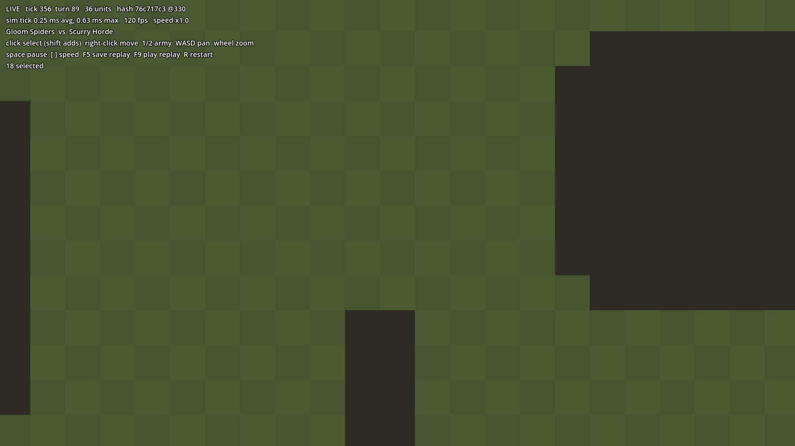

# 2026-10-10: The sim core

**Milestone:** 1 (sim core): done
**Who:** Dominic + Claude (Claude Code)

## What happened

Dominic set the brief: a deterministic, headless sim that everything else builds on. That meant
integers only, a fixed 20 Hz tick, a command queue shared by player and AI, replays, state hashes,
and a test that plays 10 minutes twice and compares every hash. Claude proposed a layout and
Dominic approved it, choosing a cost table over integer log/exp maths and asking for
`test_sim.gd` to be its own suite.

Built in five commits:
1. **Cost curve as a table.** `pow()` left pricing. The new curve is an integer table in
   `data/cost_curves.json`, and rules name a curve id. Before switching, Claude dumped every unit
   for 11 test prompts x 3 rules x 4 rerolls (659 units). After the switch all of them were
   byte-identical, race keys included.
2. **The sim.** `src/sim/`: units as parallel packed int arrays, a per-tile bucket grid, a
   CommandQueue with 4-tick turns that runs commands two turns late, straight-line MOVE with wall
   sliding, and integer separation. Separation reads start-of-tick positions so pair order can't
   matter. The state hash runs every 30 ticks.
3. **Replays.** These store the seed, the map id + content hash, the races as prompt/rules/reroll/key
   and the command log. Loading regenerates the races and checks their keys.
4. **`tests/test_sim.gd`.** It plays a scripted 12,000-tick match (200 units, 608 commands) twice
   and gets 400/400 matching checkpoints. Then it plays it again with every race dict key-reversed
   and the commands queued in shuffled order; the hashes still match. It also round-trips the
   replay through JSON, catches a one milli-tile tamper, refuses float command args, and lints
   `src/sim/` for floats, float maths, engine RNG, clocks and Nodes.
5. **Debug view.** `scenes/sim_debug.tscn` draws the sim with the Race Lab's UnitViews,
   interpolated between ticks. Click to select, right-click to move, F5 saves a replay and F9
   plays it back with live hash checks.

**Exit criterion met.** Identical hashes across runs. The tick for 200 units is **0.90 ms average**
(p99 1.26 ms, worst 10.5 ms) against a 3 ms budget, on an M4 Max. That leaves room, but a mid
laptop is the real target.

## Decisions
- D-019: units as parallel packed int arrays sorted by id
- D-020: 4-tick turns, commands run at turn + 2 in (turn, player, seq) order
- D-021: the cost curve is a checked-in integer table (Dominic's pick)
- D-022: placeholder speed/radius scales
- D-023: replays regenerate races and must reproduce their keys
- D-024: test_sim.gd is a separate, slower suite (Dominic's pick)

## Direction changes
- Milestone 5 listed the "fixed-point cost table"; it landed now, in milestone 1.
- Rules files lost `exponent` and `ref_points`; they now name a curve (`pow1.4_ref12`).

## Pictures

## Funny moments and bugs worth remembering
- **A file path became a race.** The first sim screenshot passed its output path as a command-line
  argument, and the debug view read it as player 1's prompt. The generator didn't recognise
  `/private/tmp/.../sim1.png` and ignored it, so the spiders volunteered: "Gloom Spiders". The same
  shot also had nobody on the field, because the script ordered the armies to march before they
  had spawned (spawns run two turns after they're issued, as designed). Two lockstep lessons in
  one empty picture.
- **The mutation test that passed when it shouldn't.** To prove the dict-order test works, Claude
  planted a leak: offset spawns by the length of a recipe's first key. Reversed dicts start with
  `name` instead of `slot`, and both are four letters, so the leak was invisible. Switching to the
  key's hash made the test fail at tick 30, which was the intended result.
- A GDScript parse error in a `--script` run makes Godot hang rather than exit. Headless runs now
  go through a timeout.
- Packed arrays put into an Array literal are copies, so a tidy `for a in [x, y, ...]: a.remove_at(i)`
  would have done nothing. Caught in review before it ran.

## Ideas parked
- Replays should load races from bundles (race key) instead of regenerating from prompts, so
  generator changes don't break old replays. Added to `docs/backlog.md`.
- The unit sprites are wider than their 0.3-tile collision radius, so crowds overlap visually.
  Revisit with the art pass or in milestone 2.
- Units walled in by an obstacle just stop. Flow fields in milestone 2 fix that.
