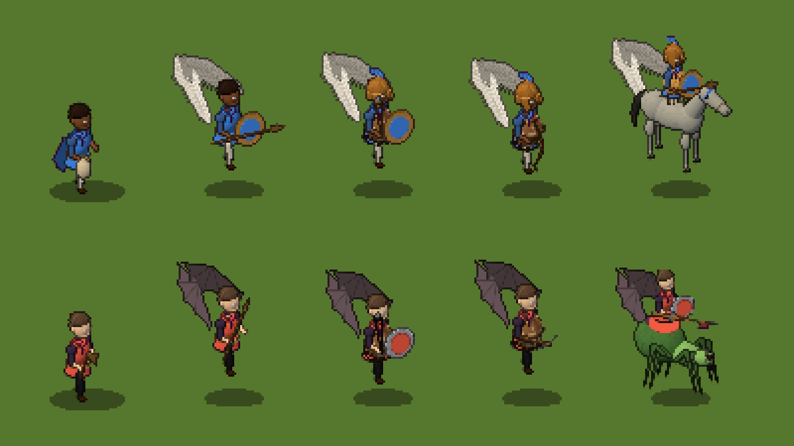
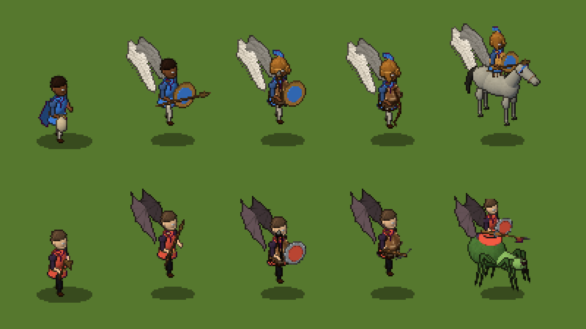

# 2026-10-11: Art and UI, stage A1

**Milestone:** art and UI track, stage A1 (alongside milestone 4, combat)
**Who:** Dominic + Claude (Claude Code; this stage ran as a separate agent in its own worktree
while another session built combat)

## What happened

Stage A1 started as five items (prop variety, realistic reeds, the wing fix, a first UI pass,
a first animation pass) and grew as Dominic looked at the game during the day.

**The wing.** Dominic's screenshot showed a winged unit whose far wing reached forward over its
head. The wing texture's root is its lower-right corner; the far wing's quad was placed so that
root sat above the head, with the tip trailing behind, so the wing read as pointing forward.
Both wings are now rooted at the shoulders and sweep back and up, the far one steeper.

**No more placeholder art anywhere.** Dominic: "so weird I'm seeing it in the race lab". The
Race Lab still drew the old vector shapes. Now `PartShape` draws only baked sprites, and a part
that was never baked warns once and shows a magenta marker instead of quietly falling back. The
Race Lab bakes each generated race through the art kit (a few hundred ms per new race, cached),
and stands the armies on the game's own ground with seeded doodads. The art kit's `prepare` was
split into units, props, buildings and atlas, and prints its timings.

Dominic then said to drop the style sampler altogether: it's history, and its pictures are in
the archive (`images/2026-10-11/08-15`). The scene and its dioramas are deleted; the bake
pipeline it held (baker, models, materials, the banner shader) moved to `src/view/art/bake/`,
since the game uses it. The sampler lives on in the archive pictures and the style-sampler
journal.

**Buildings hid units beside them.** A centaur standing beside the Roman Town Center's
lower-left face showed only its horse's legs. Buildings y-sorted by their front corner, so
anything beside the two lower faces (higher on screen than that corner) went behind the whole
building, podium and all. They now sort by the footprint's centre. `tests/art_ysort.gd` stands
a unit at every face and corner to check it.

## Decisions
- D-060: game scenes draw only baked art; a missing bake is loud; the style sampler is retired.
- D-061: buildings y-sort by their footprint's centre.

## Direction changes
- The old vector styles were kept as a fallback "just in case". Dominic wants them gone from
  everything a player or tester sees, so a missing bake is now a visible bug, not a fallback.

## Pictures

## Funny moments and bugs worth remembering
- **The ghost army.** The first Race Lab capture with two new prompts showed centaurs and
  beetles as solid white silhouettes. Each bake rebuilds the shared atlas, and the old atlas
  texture was freed while the other side's units were still drawing from it. They're redrawn
  after every bake now.
- **The swallowed rider.** Only four hooves showed below the podium; the Roman was inside the
  temple.

## Ideas parked
