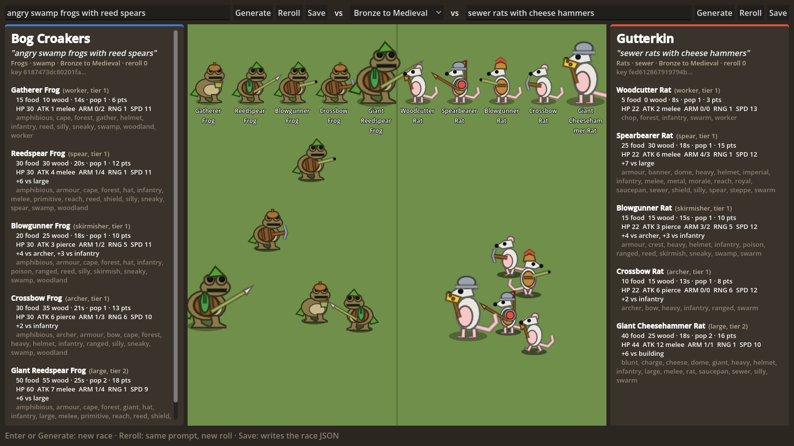
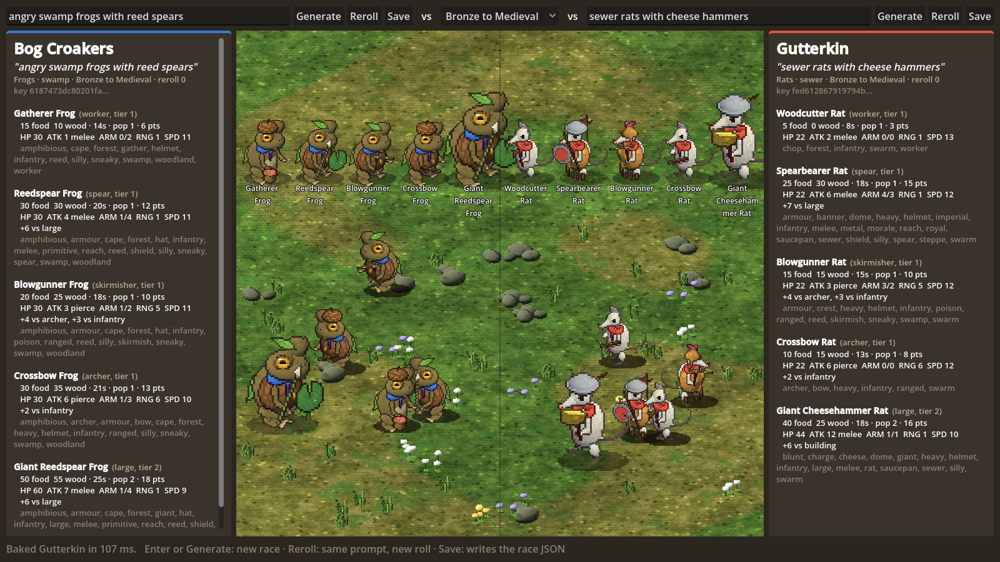
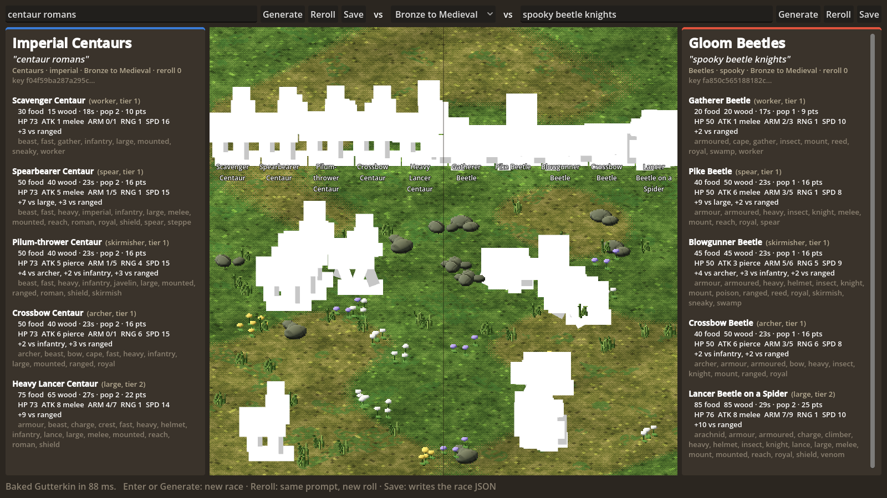
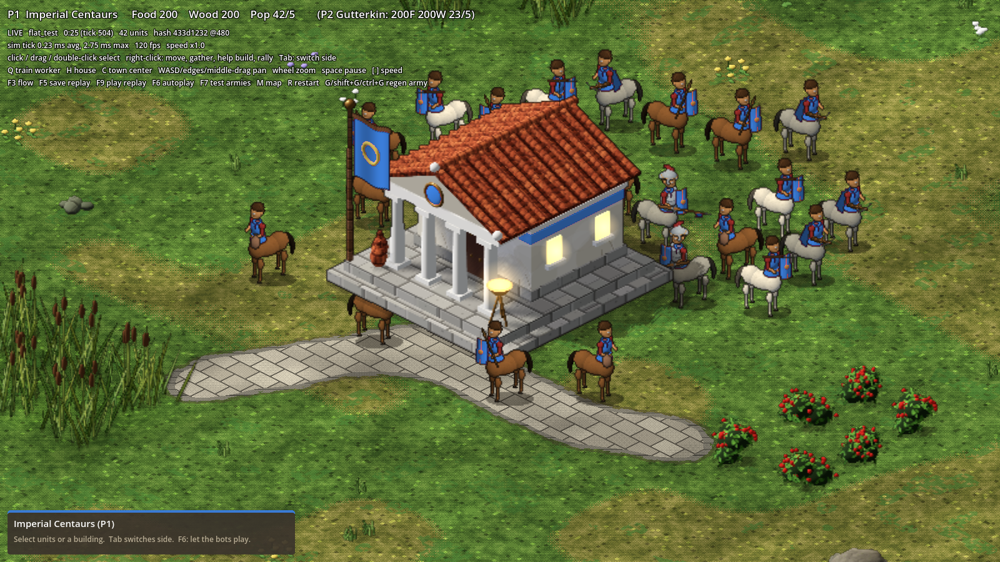

# 2026-10-11: Art and UI, stage A1

**Milestone:** art and UI track, stage A1 (alongside milestone 4, combat)
**Who:** Dominic + Claude (Claude Code; this stage ran as a separate agent in its own worktree
while another session built combat)

## What happened

Stage A1 started as five items (prop variety, realistic reeds, the wing fix, a first UI pass,
a first animation pass) and grew as Dominic looked at the game during the day.

**The wing.** Dominic's screenshot showed a winged unit whose far wing reached forward over its
head. The wing texture's root is its lower-right corner; the far wing's quad was placed so that
root sat above the head, with the tip trailing behind, so the wing read as pointing forward.
Both wings are now rooted at the shoulders and sweep back and up, the far one steeper.

**No more placeholder art anywhere.** Dominic: "so weird I'm seeing it in the race lab". The
Race Lab still drew the old vector shapes. Now `PartShape` draws only baked sprites, and a part
that was never baked warns once and shows a magenta marker instead of quietly falling back. The
Race Lab bakes each generated race through the art kit (a few hundred ms per new race, cached),
and stands the armies on the game's own ground with seeded doodads. The art kit's `prepare` was
split into units, props, buildings and atlas, and prints its timings.

Dominic then said to drop the style sampler altogether: it's history, and its pictures are in
the archive (`images/2026-10-11/08-15`). The scene and its dioramas are deleted; the bake
pipeline it held (baker, models, materials, the banner shader) moved to `src/view/art/bake/`,
since the game uses it. The sampler lives on in the archive pictures and the style-sampler
journal.

**Buildings hid units beside them.** A centaur standing beside the Roman Town Center's
lower-left face showed only its horse's legs. Buildings y-sorted by their front corner, so
anything beside the two lower faces (higher on screen than that corner) went behind the whole
building, podium and all. They now sort by the footprint's centre. `tests/art_ysort.gd` stands
a unit at every face and corner to check it.

**Variety and stages.** Every prop kind now has six seeded variants, and resource props pick
per tile so no tile repeats a neighbour (left or above). The reeds were rebuilt like the bushes:
a few hundred blade cards, dark and dense low down and lit at the tips, in sub-clumps spread
over the tile, with dried and bent blades and cattails at several heights; no base disc. Dominic
then asked for things to show their state: reed beds thin out as they're cut (cut stalks with
pale tops) and leave stubble that lingers before fading; bug bushes lose berries and go brown in
four steps; buildings under construction are baked four more times from their own models with
parts held back (foundations, then a scaffold, walls, the roof going on), which works for every
architecture without per-model work.

**Bake time.** 86 prop bakes at one render each would have cost several seconds, so props bake
nine to a render. Most of a bake turned out to be GDScript pixel loops, not rendering: ground
shadows are now painted at art resolution, Pixelize works on raw bytes and shrinks with
premultiplied alpha instead of `fix_alpha_edges` (the slowest step). Match start went from
about 5 s for 38 bakes to about 2.9 s for 102 (units 0.2 s, props 1.1 s, buildings with stages
1.6 s). Measurements are only meaningful with the window visible: a hidden or throttled window
draws frames slowly, and the same bake took 70-120 s in a background run.

**UI pass 1.** The command panel shows a portrait of what's selected (each unit's own baked art,
rendered by the art kit into an icon at match start; buildings show their bake), a health bar, a
tray of portraits with counts for groups, square picture buttons with hotkeys and costs, and a
big training queue whose first slot carries a progress bar. Cursors are authored SVGs (pointer,
move, forage, chop, build, rally, attack), picked by what a right-click would do.

**Animation pass 1.** Walk cycles by body: bipeds stride and bob, four legs rock, six and eight
legs scuttle, flyers hover with dangling legs and flapping wings. Workers at their job forage,
chop or hammer, facing the work, and standing units fidget now and then.

**Gear that floats.** Beetles, spiders and ponies have no arms, so their spears and shields
hovered at their flanks. They now wear a harness: a girth strap, a holder where the weapon lies
couched forward (turned by the tip found in its bake, so it works however the weapon was
modelled) and a pad for the shield. Then Dominic spotted a pilum floating across a centaur's
shoulders: the review round had given weapons distinct silhouettes by moving the weapon, not the
arm. Each body now bakes its near arm in a pose chosen from the weapon's tags (low, throw, mouth,
overhead, draw, shoulder, aim), and those weapons are rebuilt around their grip.

**Riders with no arms.** A spider riding a pony sat on it like a person, legless, covering the
pony's head. Armless riders now ride small and low, belly in the saddle, near legs hugging the
mount's flank. Better, though still odd at game size; a data flag to rule such pairs out is
proposed in the report, in case Dominic still doesn't like them.

**Realism pass on the ground.** Roads are irregular, bevelled, worn slabs with dirt joints and
broken edges instead of a regular grid; cobbles vary and hold dirt and moss; boardwalks have
grain, grey boards, post tops and a shadow; trails have ruts; grass drifts in hue with clumps
and worn soil; the swamp is mud, moss, puddles, sedge and algae instead of a flat teal smear;
water catches the sky. Thatch was redrawn as clumped, angled bundles (it aliased into a
barcode).

## Decisions
- D-060: game scenes draw only baked art; a missing bake is loud; the style sampler is retired.
- D-061: buildings y-sort by their footprint's centre.
- D-062: props and buildings bake without the units' outline; props bake several to a render.
- D-063: resources and buildings show their state in baked stages.
- D-064: armless bodies carry gear on a harness; bodies bake once per weapon hold.

## Direction changes
- The old vector styles were kept as a fallback "just in case". Dominic wants them gone from
  everything a player or tester sees, so a missing bake is now a visible bug, not a fallback.

## Pictures

## Funny moments and bugs worth remembering
- **The ghost army.** The first Race Lab capture with two new prompts showed centaurs and
  beetles as solid white silhouettes. Each bake rebuilds the shared atlas, and the old atlas
  texture was freed while the other side's units were still drawing from it. They're redrawn
  after every bake now.
- **The swallowed rider.** Only four hooves showed below the podium; the Roman was inside the
  temple.

## Ideas parked
