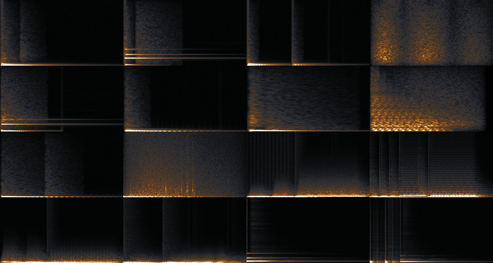
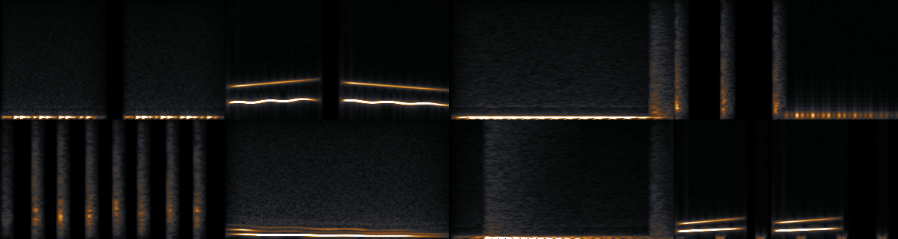

# 2026-10-11: Sound from the ground up, and music

**Milestone:** after 11 (audio was a backlog line: "unit barks in silly voices, music")
**Who:** Dominic (the ask) + Claude (Claude Code)

## What happened
Dominic: "Please take a look at our sound effects, they need re-working from ground up, and we
need some music." The old set was sixteen sine-and-noise blips synthesised in GDScript at
start-up: one take each, 22 kHz, no bodies, no mix, no music. Everything went.

The new set is *files*, like the `.glb` models: our own synthesiser in pure Python
(`tools/audio/`; this Mac has no numpy, sox is broken and ffmpeg only has the built-in Vorbis
encoder, so pure Python it was; it renders the lot in 15 seconds) writes `assets/audio/`.
Twenty-eight effects with two to four takes each, built as physical things (an axe biting reed,
a pick ringing stone, a mallet, a wooden token for the UI click, a page turning for a tip);
blows by weapon tag (blade, blunt, pierce), shots by projectile kind with the arrow landing when
the view's shot does; eight creature voices (frog croak, rat squeak, human grunt, beetle clacks
and buzz, spider chitter, pony whinny, centaur grunt and stamp, capybara chirrup) for select,
ack and die; stings in the music's key.

The music is one theme, "Whatever", D Dorian at 92, 32 bars, written as text notes and rendered
as six seamless stems: lute and frame drum from age 1, flute and drone from age 2, horns from
age 3, and a battle layer of war drums and a ragged horn that fades in while your units fight
on screen. One `AudioStreamSynchronized` plays them all; ageing up adds instruments without a
cut. The lobby plays the gentle mix; victory and defeat fade it under their sting.

In the game: `src/view/audio.gd` (one node under the root, buses, round-robin takes, gaps and
voice counts, deferred calls until it's in the tree), `data/audio.json` (the mixes and every
sound's settings), `voice` on each creature. A test checks every file is there and loads.

## Decisions
- D-103: sound is rendered files from our own offline synth; creature voices; the theme in stems by age.

## Direction changes
"Placeholder synth until we have sound files" -> the synth *is* the source of the sound files.
No downloads, no sample packs, everything ours and reproducible, in the spirit of the art
pipeline (recipes in, baked assets out).

## Pictures

## Funny moments and bugs worth remembering
- The first harmony helper put the flute's third above A4 at C4, a seventh *below*: the scale
  was written from D, but octave numbers turn over at C. Writing the scale as "CDEFGAB" fixed
  the lot in three lines.
- Nothing here has been heard by a human. Every sound was judged by its length, peak, RMS, a
  pitch guess and a spectrogram. The lute reads 292 Hz for D4 (293.7); the sheets look like
  what they're meant to be. Dominic's ears are the real test.
- The audio node tried to join the tree's root from inside a scene's `_ready` and Godot
  refused ("parent node is busy setting up children"); so it joins a frame later and defers
  any call made before that.

## Ideas parked
- A second theme or mode; ambience by map (night, swamp, sewer); voices by size and culture;
  a "can't" bark; volume sliders. (All in `docs/backlog.md`.)
