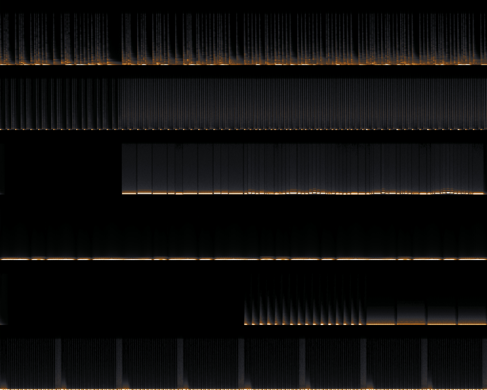

# 2026-10-11: Sound from the ground up, and music

**Milestone:** after 11 (audio was a backlog line: "unit barks in silly voices, music")
**Who:** Dominic (the ask) + Claude (Claude Code)

## What happened
Dominic: "Please take a look at our sound effects, they need re-working from ground up, and we
need some music." The old set was sixteen sine-and-noise blips synthesised in GDScript at
start-up: one take each, 22 kHz, no bodies, no mix, no music. Everything went.

The new set is *files*, like the `.glb` models: our own synthesiser in pure Python
(`tools/audio/`; this Mac has no numpy, sox is broken and ffmpeg only has the built-in Vorbis
encoder, so pure Python it was; it renders the lot in 15 seconds) writes `assets/audio/`.
Twenty-eight effects with two to four takes each, built as physical things (an axe biting reed,
a pick ringing stone, a mallet, a wooden token for the UI click, a page turning for a tip);
blows by weapon tag (blade, blunt, pierce), shots by projectile kind with the arrow landing when
the view's shot does; eight creature voices (frog croak, rat squeak, human grunt, beetle clacks
and buzz, spider chitter, pony whinny, centaur grunt and stamp, capybara chirrup) for select,
ack and die; stings in the music's key.

The music is one theme, "Whatever", D Dorian at 92, 32 bars, written as text notes and rendered
as six seamless stems: lute and frame drum from age 1, flute and drone from age 2, horns from
age 3, and a battle layer of war drums and a ragged horn that fades in while your units fight
on screen. One `AudioStreamSynchronized` plays them all; ageing up adds instruments without a
cut. The lobby plays the gentle mix; victory and defeat fade it under their sting.

In the game: `src/view/audio.gd` (one node under the root, buses, round-robin takes, gaps and
voice counts, deferred calls until it's in the tree), `data/audio.json` (the mixes and every
sound's settings), `voice` on each creature. A test checks every file is there and loads.

## Decisions
- D-103: sound is rendered files from our own offline synth; creature voices; the theme in stems by age.

## Direction changes
"Placeholder synth until we have sound files" -> the synth *is* the source of the sound files.
No downloads, no sample packs, everything ours and reproducible, in the spirit of the art
pipeline (recipes in, baked assets out).

## Pictures

## Funny moments and bugs worth remembering
- The first harmony helper put the flute's third above A4 at C4, a seventh *below*: the scale
  was written from D, but octave numbers turn over at C. Writing the scale as "CDEFGAB" fixed
  the lot in three lines.
- Nothing here has been heard by a human. Every sound was judged by its length, peak, RMS, a
  pitch guess and a spectrogram. The lute reads 292 Hz for D4 (293.7); the sheets look like
  what they're meant to be. Dominic's ears are the real test.
- The audio node tried to join the tree's root from inside a scene's `_ready` and Godot
  refused ("parent node is busy setting up children"); so it joins a frame later and defers
  any call made before that.

## Ideas parked
- A second theme or mode; ambience by map (night, swamp, sewer); voices by size and culture;
  a "can't" bark; volume sliders. (All in `docs/backlog.md`.)

## Later the same day: Dominic listened
The chop went through three versions in a few minutes: "sounds like a drum" (a 180 Hz body
ringing for 200 ms), then "two pipes hitting together" (three pure, evenly spaced partials),
then "perfect" (a noisy crack through a wood-coloured band, a damped tok at wood-block ratios
gone in 30 ms, a bright bite and splitting fibres). The pick on stone was good first time and
the mallet "sounds more like wood", so it became the reference. The lesson for synthesised
foley: wood is damped and noisy; pure ringing partials read as metal, a long low body as a
drum. He asked whether we need open-source sounds; the answer for now is no, with a CC0 pack
as the fallback for foley if a sound won't come right. Voices and music still to be judged.
Second round: the blade hit went from "sounds like mining" (it rang at the pick's pitches) to
"worse" (a thud added) to "that's better, if we hear lots of them it'll work" (a click, a long
shimmering steel ring and a high shing, no weight). The human shout, moved up to 172 Hz with
an 'h' at the front, is "ok"; the frog went lower and darker to keep clear of it. Three
materials, three rules: wood damped and noisy, stone short and gritty, metal bright and ringing.
Third round: the arrow. A ringing pluck was "very twangy"; a damped slap with a hiss was
still wrong ("hard to describe"); Dominic's steer was "focus on the sound of the arrow in air",
so the shot is now the flight alone, a band of air falling in pitch as it leaves with a thin
fletching whistle inside, and a soft tap for the loose. "Let's do that for now": accepted, with
the door open for real foley if it never quite lands. The spear hit became a point, a punch
into hide and the shaft's knock.

## Later still: a pathing pass (D-104)
Dominic: "some issues occasionally". A new audit (`tests/path_audit.gd`) played bot matches and
counted units teleporting, jittering, treading in place or giving up, with where. The root was
one thing: "stuck" meant exact zero motion before the separation pushes, so a sheep wedged
between a rock and a planted builder moved every tick, was pushed straight back, and never
counted as stuck; nor did gatherers jostling round a full bush. Stuck is now net progress
along the flow field every two seconds. With it: a line check as wide as the body (no more
corner-cutting waypoints), bodies eased off walls at most 150 milli-tiles a tick instead of
popping a tile, flow fields that reach a bush from its corners, crowded-off gatherers taking
another tile, claimed sheep trying another spot round the Town Center, and group moves given
three times the patience at a gap. The choke map turned out to have no food or wood on it at
all (both bots sat idle from the first minute): it left the lobby. The body-wide line check
costs about half a millisecond a tick at 143 units (2.7 ms against 2.2; budget 3): three
samples where there was one. A freed unit view assigned to a typed variable in the combat
effects (a flash landing on a unit already dead) threw an error every time; untyped now.
