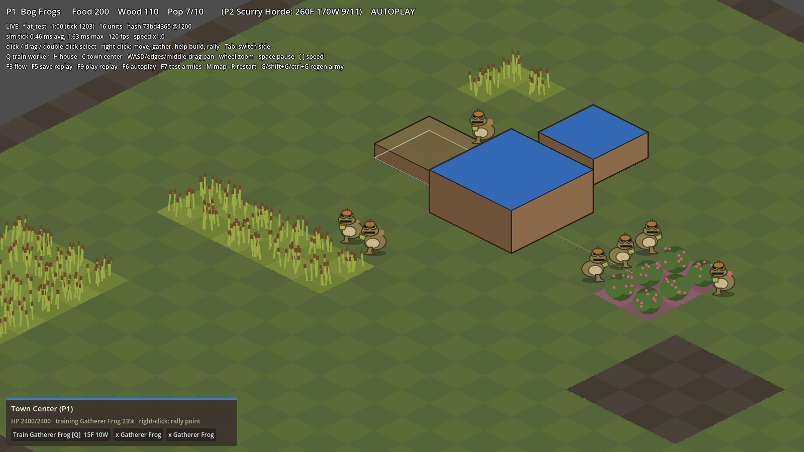
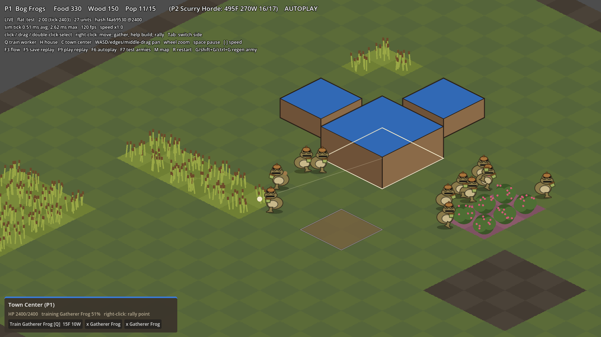
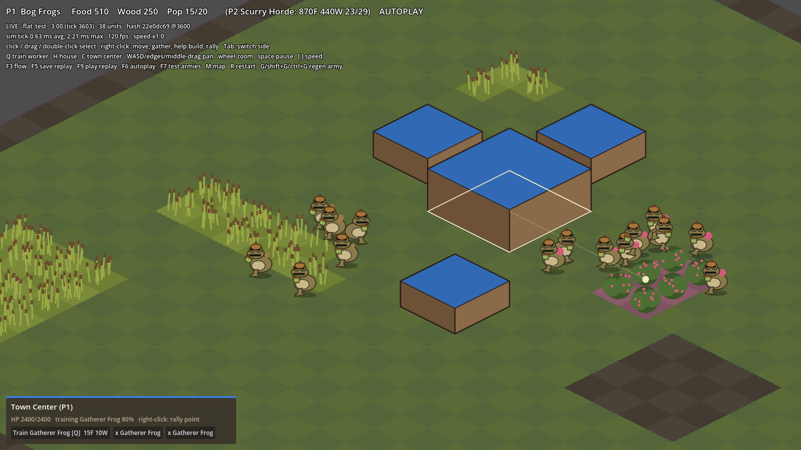

# 2026-10-11: The economy

**Milestone:** 3 (economy): built; exit check is Dominic watching an opening
**Who:** Dominic + Claude (Claude Code)

## What happened

(Written as it goes.)

- Dominic approved the plan, choosing cut reeds that **become walkable** and a **minimal
  clickable panel**. He also asked for a test hotkey to regenerate an army (G / Shift+G / Ctrl+G
  in the debug view) and for CLAUDE.md to insist on archive pictures and notes as we go.
- **Data first:** reeds hold 100 wood, new bug bushes hold 2,000 food, `buildings.json` defines
  the Town Center and House, the rules gained an economy block, and rats got
  `economy: {cost_pct 70, train_time_pct 80, house_pop 6}` in `creatures.json`. No code knows
  about rats.
- **The sim:** the map became mutable (resources run out, buildings occupy tiles). Flow fields
  grew multiple sources ("anywhere next to this Town Center") and a cost cutoff, so short work
  trips solve in ~0.4 ms instead of ~2.4. A map change only drops the fields it could affect.
  Workers gather, carry 10, drop off at the nearest drop-off and walk back.
- **The economy bot** (`src/ai/eco_bot.gd`): keeps the TC busy, splits workers 60/40
  food/wood, builds houses before pop runs out, and puts idle workers back to work. It only
  issues commands, like a player, and it's the seed of the milestone 6 AI.
- **3-minute opening, frogs vs rats:** frogs reach 15 workers and 3 houses and gather 800;
  rats reach 23 workers and 4 houses (6 pop each) and gather 1,140. No stalls, nobody over the
  pop cap, all deterministic.

- **The view:** placeholder isometric buildings whose walls rise as they're built, reed and
  bug-bush props that thin out, carried loads above heads, a top bar and a clickable command
  panel (Q, H, C, cancel by click), smart right-click, and Tab to command the other side. F6
  hands both sides to the bot. Every UI path was checked by pushing real mouse and key events
  through Godot.
- The view-driven opening reached exactly the same numbers at 3:00 as the headless test
  (frogs: 510 food, 250 wood, 15/20 pop).

## Decisions
- D-031: cut reeds become walkable (Dominic)
- D-032: minimal clickable panel + hotkeys (Dominic)
- D-033: the economy is data, including race-wide modifiers from creatures
- D-034: train time from data on a flatter curve
- D-035: multi-source fields with a cutoff, touch-based invalidation, a solve budget
- D-036: gatherers spread over a clump
- D-037: AI players in src/ai/, deterministic and linted
- D-038: replays pin the rules
- D-039: army-regeneration hotkeys (Dominic)

## Pictures

## Funny moments and bugs worth remembering
- **"Q doesn't work!"** It did. The UI test checked a quarter of a second after the key press,
  and orders land two turns (up to 0.6 s) later. Same lesson as milestone 2, in a new place.
- **Two-second workers.** The old pricing gave a worker a 2-3 s train time; the Town Center
  would have sprayed frogs like a hose. Train time moved into data with a flatter curve: a
  worker now takes 11-14 s, a spear ~20 s, a large unit ~27 s.
- **Everyone on one bush.** The first opening gathered half of what it should. The diagnosis:
  every worker had been sent to the *same* bug bush tile, and only a few fit around one tile,
  so the rest queued and jostled (45% of their time "walking to work"). Now a worker sent to a
  busy tile takes the quietest one within 2 tiles. Gathering doubled.
- **Two full solves in one tick.** A solve budget of 5,000 cells let two full-map solves share
  a tick (p99 jumped to 6.4 ms). The budget is now 1,500: one full solve, or a few short ones.

## Ideas parked
- Dominic: the UI should adapt to your generated race (style, colours, extra bits and bobs).
  In the backlog under art and presentation; families already carry colours to build on.
- Workers are cheap (frogs 25, rats 5 food), so banks pile up and the Town Center is the
  bottleneck. That's a balance question for milestones 5 and 8.
