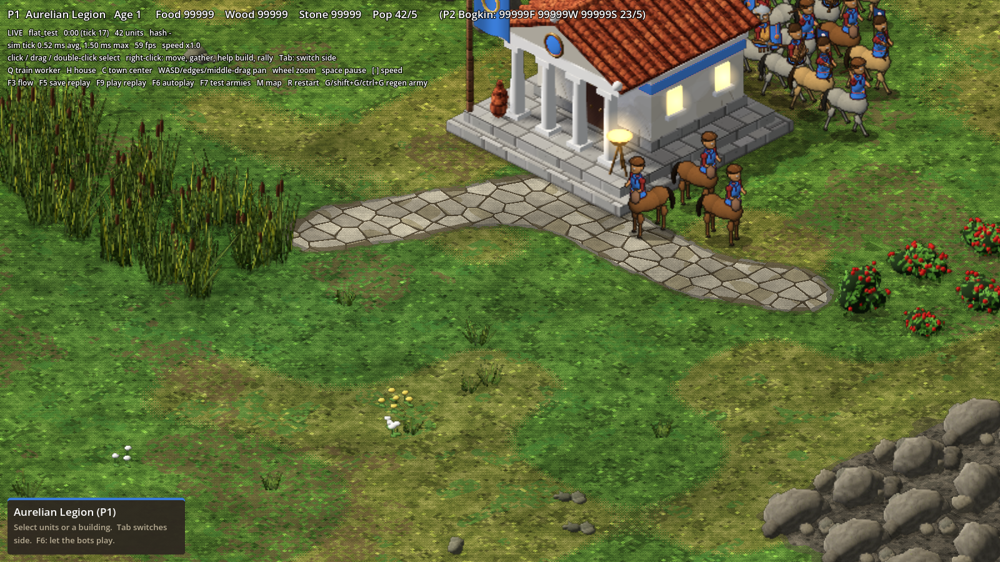
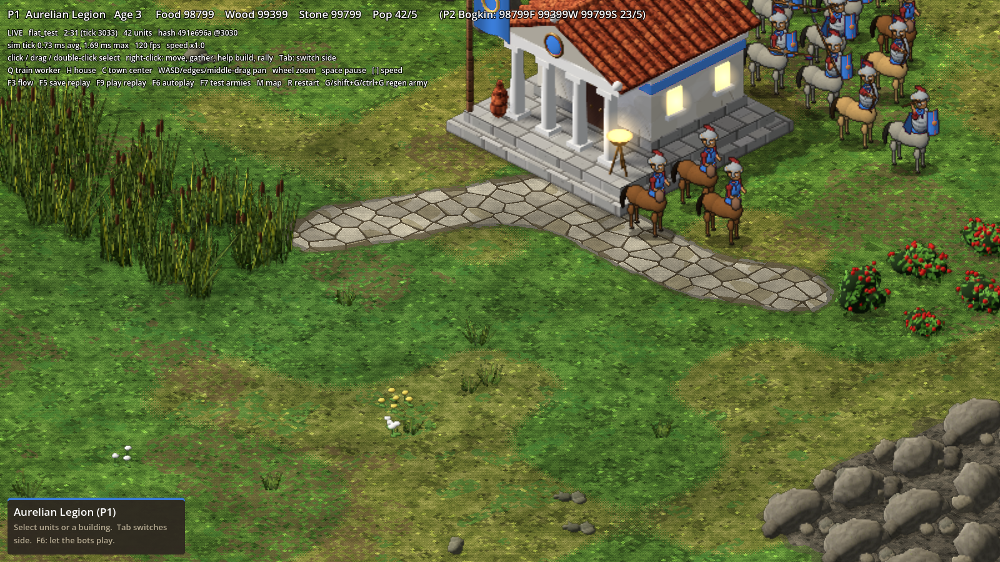
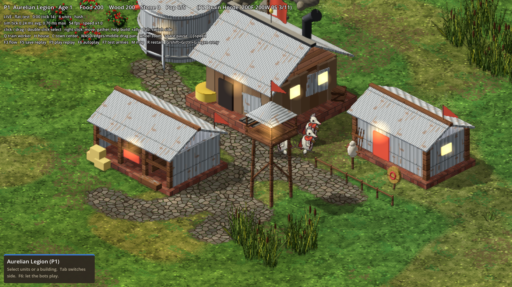
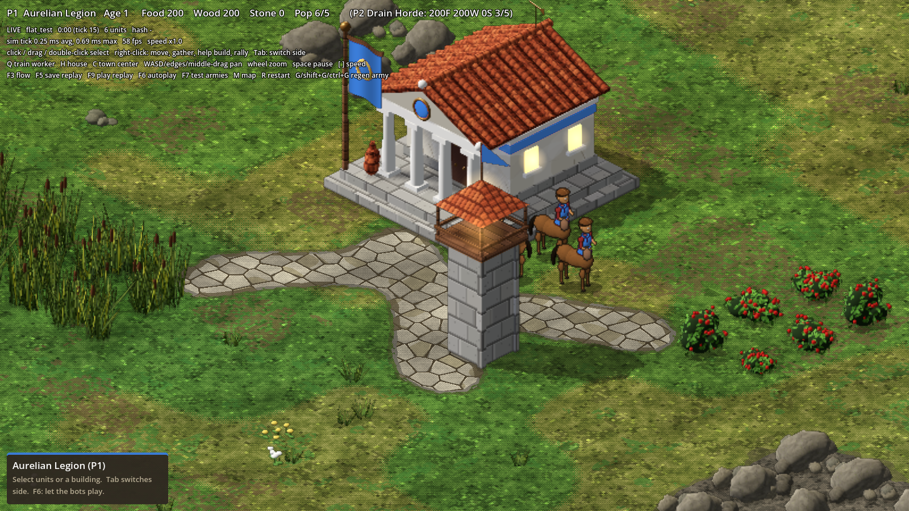
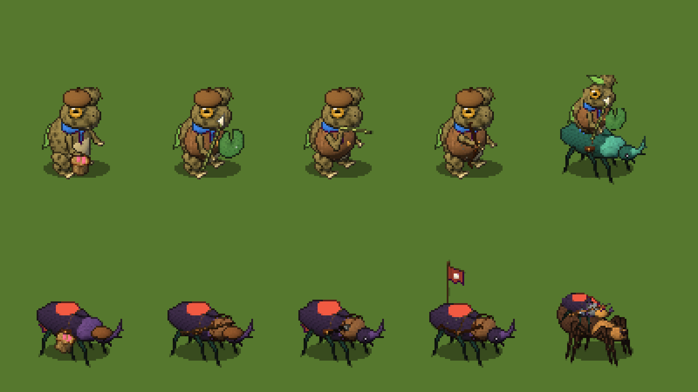
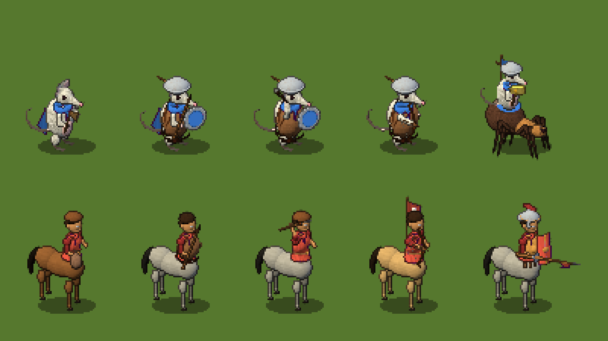
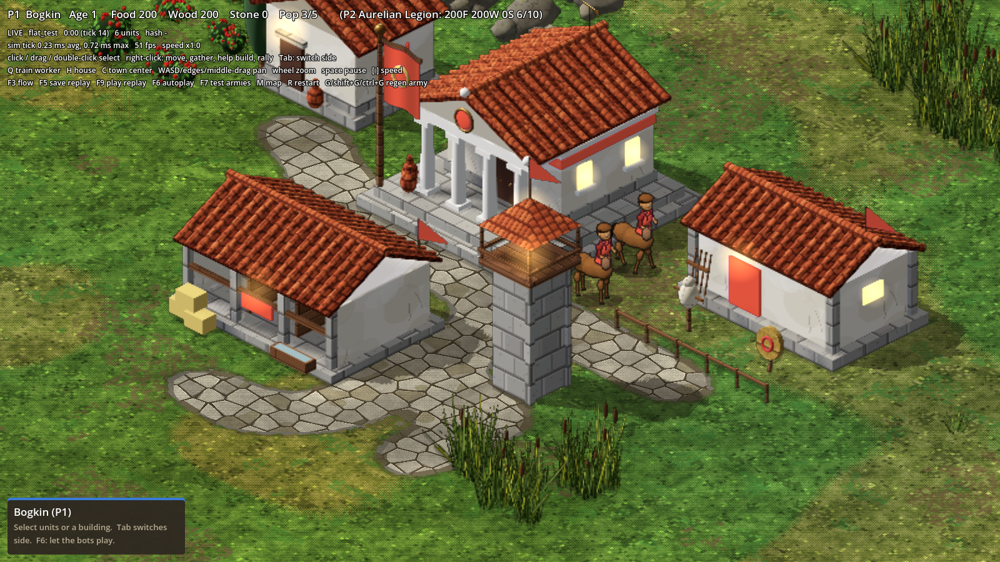

# 2026-10-11: Milestone 6, foundations

## What happened
Dominic asked which cut-list items get harder to add the longer we wait, and turned the answer
into a milestone. Claude built it right after combat, while the art agent worked on milestone 5
(until it hit the account's weekly limit and Claude merged its work).

In order:
- **Resources from data.** Food, wood and stone in `data/resources.json`; stock, costs, carried
  loads and drop-offs are vectors. Stone deposits sit near each start and mine out to rubble.
- **Teams.** `is_enemy()` instead of owner comparisons; a 2v2 test.
- **Movement classes.** Ground, amphibious and flying, each with its own walkability and flow
  fields. A shallow rim round the lake lets frogs wade where rats can't, and flyers cross it.
- **Placement and farms.** A building goes where its owner's builders can stand. A farm becomes a
  crop field, or a rice paddy in the shallows for amphibians.
- **Shift-queued orders** (Dominic): a worker builds, then goes foraging.
- **Unit lines through the ages** (Dominic: "Romans can't just look heavily armoured for all
  ages"). Parts have tiers; each unit is written as a line, upgrading within its kind and culture.
- **Ages and research as data.** An age-up moves the player's units along their lines, and the
  game view shows the change.

Milestone 7 (progression) followed straight on:
- **Buildings:** the Barracks, Stable and Watchtower, each in four cultures' materials and roofs.
- **Gates:** buildings and units unlock with the age.
- **Watchtowers** shoot.
- **The bot** builds a Barracks, saves and ages up. Frogs reach age 2 at 5:21, rats at 4:21;
  without a building requirement, the rats' cheap workers got them there at 3:06.- **Unit textures (art, milestone 5).** Dominic: the buildings and props now look better than
  the units. Brighter bake light changed nothing, which gave the bug away: unit materials mapped
  textures in each mesh's own space, and bodies are scaled unit spheres, so a whole horse got a
  sliver of texture. In world space, with regenerated textures (big blotches, tufts, folds,
  plates), frogs read as toads and beetles get shell plates. The cap stopped looking like an acorn
  too, since its grain is now visible as cloth.

## Decisions
D-056 (milestones 5 and 6 inserted), D-057 (gear by age, small blacksmith tells), D-058 (bows for
everyone, crossbows royal and rat kit, shift-queues), D-059 (winged races fly instead of riding),
D-070 (restrictions as layers with a host switch), D-072 (unit textures: big marks, world space).

## Pictures

## Funny moments
- The first unit lines gave every soldier a banner at age 2, replacing their capes. A whole
  army of standard-bearers. Upgrades now keep the kind of thing they replace.
- Royal knights started the game with reed spears and blowguns: frog kit, because nothing said
  it wasn't theirs. The reed spear and blowgun are woodland signature kit now.
- "Pegasus riders" gave every foot soldier wings too.
- Doubling the sun's strength on the units changed nothing visible. Every horse had been wearing
  one enormous magnified speck of its own coat texture.

## Ideas parked
- Tier-2 and tier-3 woodland kit (turtle-shell shields, thorn spears, chitin armour): frogs reach
  for bronze and iron today.
- Creature variants per line (roster-template.md).
