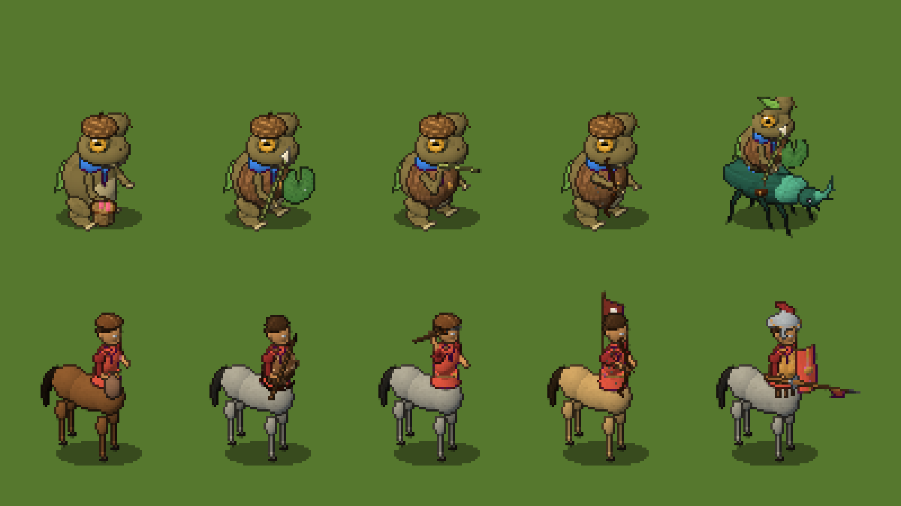
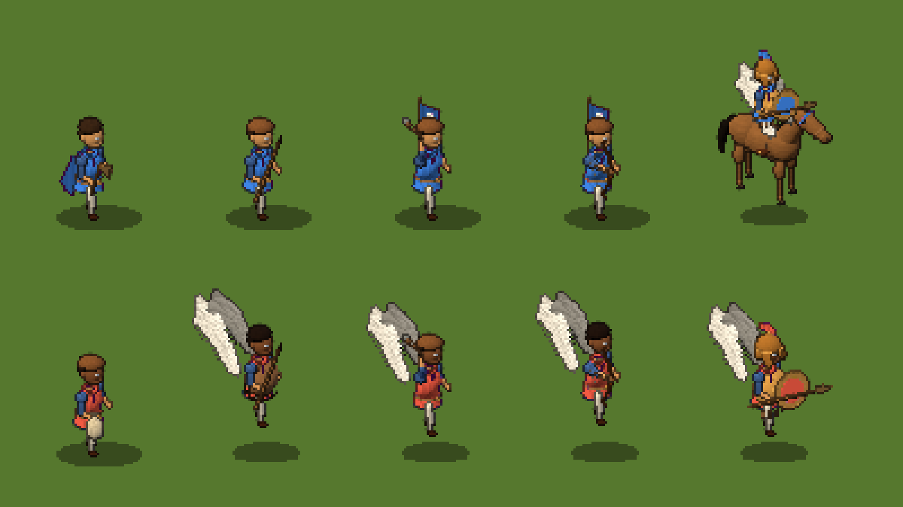
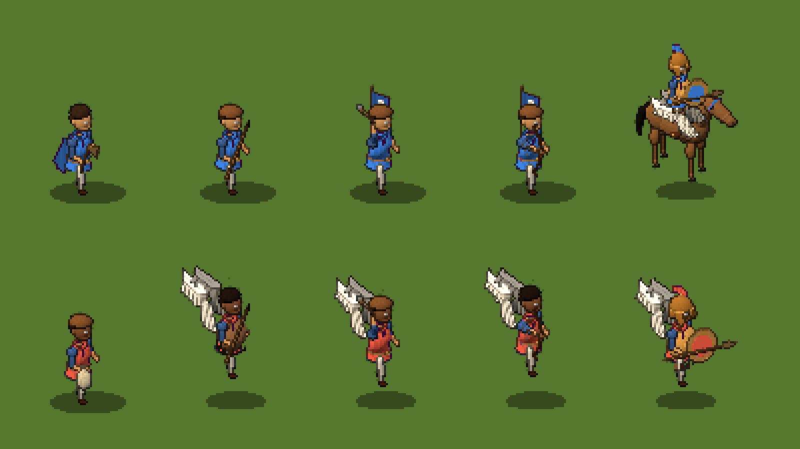
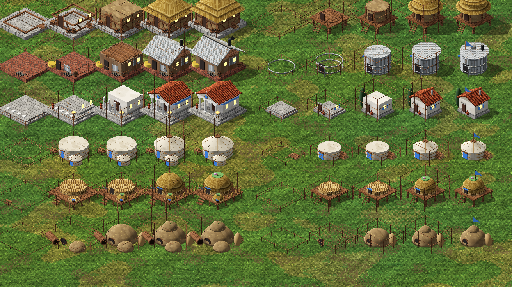
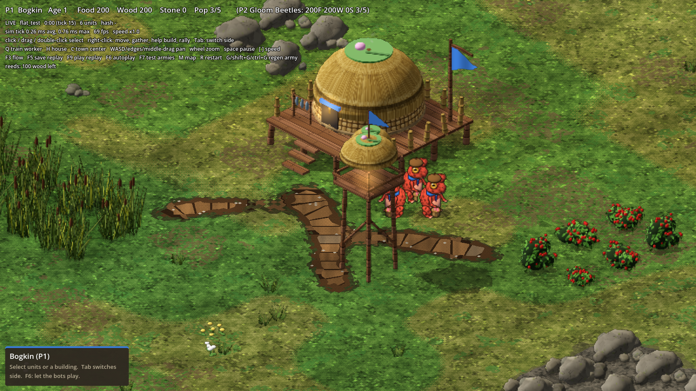
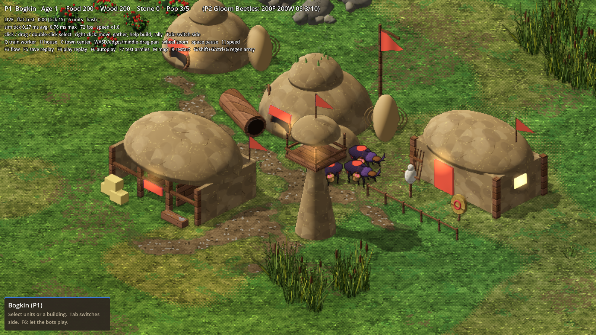
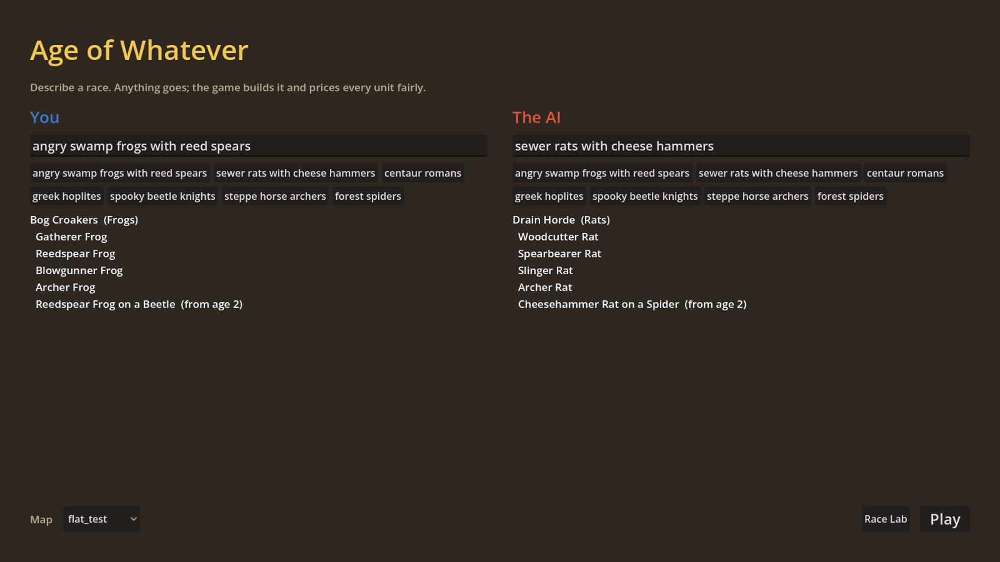
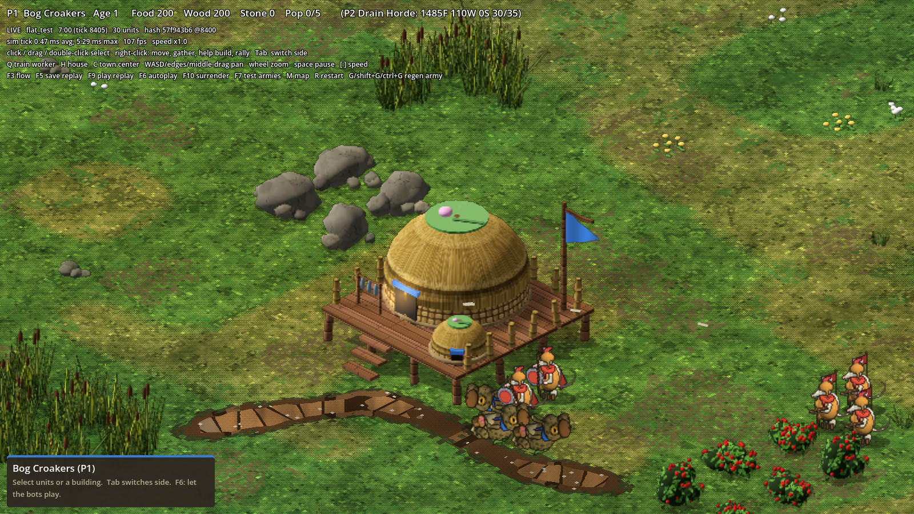
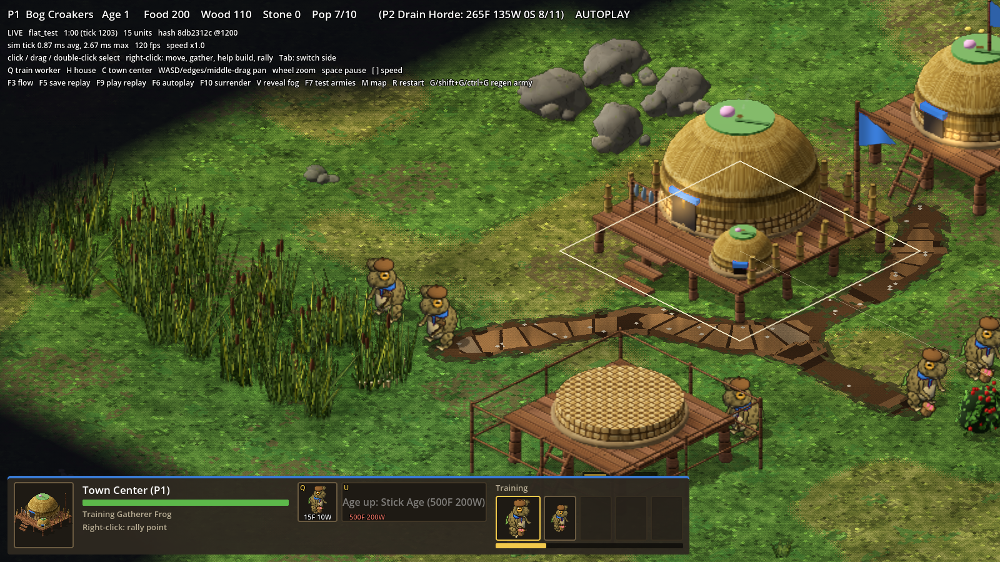
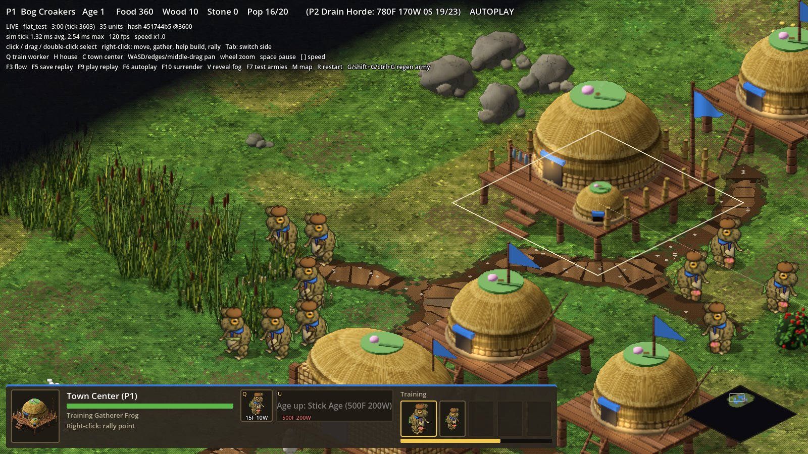

# 2026-10-11: Milestone 6, foundations

## What happened
Dominic asked which cut-list items get harder to add the longer we wait, and turned the answer
into a milestone. Claude built it right after combat, while the art agent worked on milestone 5
(until it hit the account's weekly limit and Claude merged its work).

In order:
- **Resources from data.** Food, wood and stone in `data/resources.json`; stock, costs, carried
  loads and drop-offs are vectors. Stone deposits sit near each start and mine out to rubble.
- **Teams.** `is_enemy()` instead of owner comparisons; a 2v2 test.
- **Movement classes.** Ground, amphibious and flying, each with its own walkability and flow
  fields. A shallow rim round the lake lets frogs wade where rats can't, and flyers cross it.
- **Placement and farms.** A building goes where its owner's builders can stand. A farm becomes a
  crop field, or a rice paddy in the shallows for amphibians.
- **Shift-queued orders** (Dominic): a worker builds, then goes foraging.
- **Unit lines through the ages** (Dominic: "Romans can't just look heavily armoured for all
  ages"). Parts have tiers; each unit is written as a line, upgrading within its kind and culture.
- **Ages and research as data.** An age-up moves the player's units along their lines, and the
  game view shows the change.

Milestone 7 (progression) followed straight on:
- **Buildings:** the Barracks, Stable and Watchtower, each in four cultures' materials and roofs.
- **Gates:** buildings and units unlock with the age.
- **Watchtowers** shoot.
- **The bot** builds a Barracks, saves and ages up. Frogs reach age 2 at 5:21, rats at 4:21;
  without a building requirement, the rats' cheap workers got them there at 3:06.- **Unit textures (art, milestone 5).** Dominic: the buildings and props now look better than
  the units. Brighter bake light changed nothing, which gave the bug away: unit materials mapped
  textures in each mesh's own space, and bodies are scaled unit spheres, so a whole horse got a
  sliver of texture. In world space, with regenerated textures (big blotches, tufts, folds,
  plates), frogs read as toads and beetles get shell plates. The cap stopped looking like an acorn
  too, since its grain is now visible as cloth.
- **Creature architecture.** Frogs now weave reed domes on stilt decks with lily-pad caps;
  beetles and spiders dig earth mounds with round doors, a hollowed log and seed-husk sheds,
  and their watchtower is a termite spire. A creature's architecture overrides its culture's.
- **Concept-first art (Dominic).** "Things are improving but we seem to be iterating on the
  original designs." Every culture's age-1 units wore the same brown cap. Instead of tweaking it,
  Claude built a concept sheet tool and drew variations for Roman, Viking and Greek head gear.
  The game-scale sheet made the real problem obvious: five Viking heads, nearly identical at
  8 pixels. Questions for Dominic in `docs/concepts/README.md`. Pegasus wings went to double
  size at his request.
- **Milestone 8, AI and match flow.** A full AI on top of the economy bot: build order from data,
  counter-picked soldiers, defence, waves at 5 and 8 minutes. It beats a passive player in 10-14
  minutes; frogs vs rats bot-on-bot goes to the rats at 14:22. Losing your Town Centers or
  pressing F10 ends the match. A match setup screen with live race previews is the new front door.
- **Milestone 9, fog and juice.** Fog of war (the AI plays by it too), a diamond minimap,
  synthesised placeholder sounds. The 9-12 minute check caught two AI bugs: armies razing every
  house before the Town Center, and frogs hacking at a Town Center while a lone centaur cut them
  down one by one. Median bot match now 10:50.
- **Milestone 10, prepared.** A balance tool that fights every soldier against every other at
  equal cost. Beetle spearmen won all 19 of their fights; archers almost none. Part prices moved,
  workers got one price (a centaur worker had cost three frogs), and counters went to 91%. Chasing
  a bot-match length, Claude dropped the AI's guard and then put it back when Dominic asked what
  was wrong with it. Nothing was. A playtest kit and match log are ready for testers.
- **Workers' prices vary again (Dominic).** "A centaur should move faster and carry more than a
  human, so more expensive to balance out." The flat price came out; centaurs carry 160% a trip.
- **A price tuner.** It nudged part points until the win-rate table was flat (11 outliers to 6),
  by making bows nearly free, at which point archers beat their own counters. Bows went back.
  Lesson: no price fixes archers that can't keep their distance.
- **Dominic playing.** Train buttons didn't work by clicking (the panel rebuilt itself every frame
  because a building's portrait was a new texture each time, so clicks never landed); units could
  only be clicked by their feet (now their whole figure); foraging restarted mid-motion (the
  animation was tied to a counter that resets every unit of food). Farms became one walkable,
  reseedable thing (D-079), a selected building shows its rally flag, and centaur workers cost
  more again but carry 160% (D-078).
- **Milestone 3 closed:** Dominic watched a bot opening: "all looks good". He spotted two
  workers at one berry bush trading places for ever: spacing pushed the working one out of reach.
  Workers at their job now overlap freely, and passers-by give way.
- **Frogs picked:** the crouched leaper (A); the bullfrog (C) kept for another unit or an
  upgrade. "If frogs hop instead of walk it'll be pretty cool."
- **Wings.** Feather wings had thirty small feathers and baked to a white slab; now eight big
  ones. A pegasus's wings sat so high they looked like the rider's; they now lie folded along
  the horse's back.

## Decisions
D-056 (milestones 5 and 6 inserted), D-057 (gear by age, small blacksmith tells), D-058 (bows for
everyone, crossbows royal and rat kit, shift-queues), D-059 (winged races fly instead of riding),
D-070 (restrictions as layers with a host switch), D-072 (unit textures: big marks, world space), D-073 (creature architecture), D-074 (concept-first unit art), D-075 (the AI and the match setup), D-076 (workers have one price), D-077 (pacing is a tester metric), D-078 (worker costs vary; centaurs carry more), D-079 (one walkable, reseedable farm).

## Pictures

## Funny moments
- The first unit lines gave every soldier a banner at age 2, replacing their capes. A whole
  army of standard-bearers. Upgrades now keep the kind of thing they replace.
- Royal knights started the game with reed spears and blowguns: frog kit, because nothing said
  it wasn't theirs. The reed spear and blowgun are woodland signature kit now.
- "Pegasus riders" gave every foot soldier wings too.
- Doubling the sun's strength on the units changed nothing visible. Every horse had been wearing
  one enormous magnified speck of its own coat texture.

## Ideas parked
- Tier-2 and tier-3 woodland kit (turtle-shell shields, thorn spears, chitin armour): frogs reach
  for bronze and iron today.
- Creature variants per line (roster-template.md).
