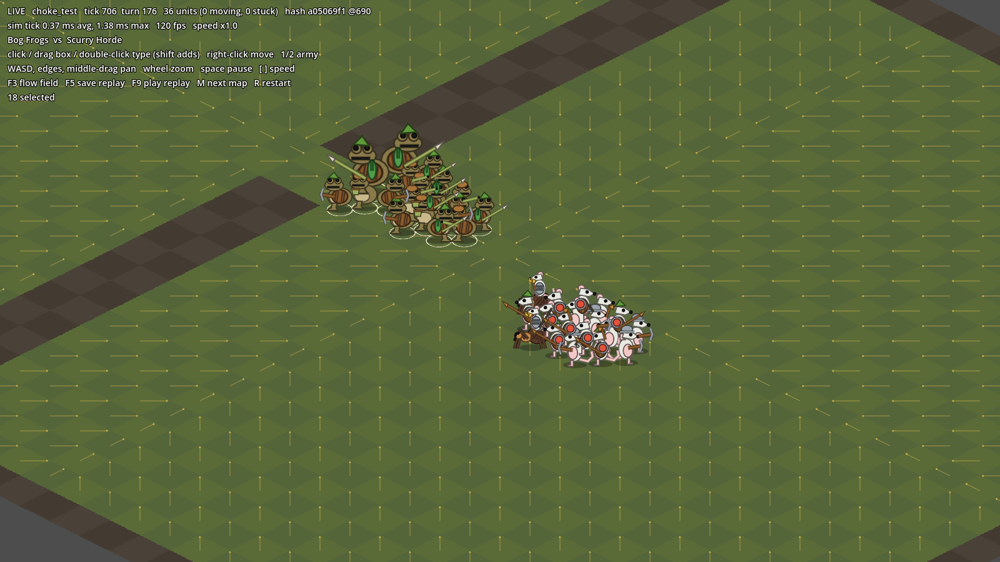
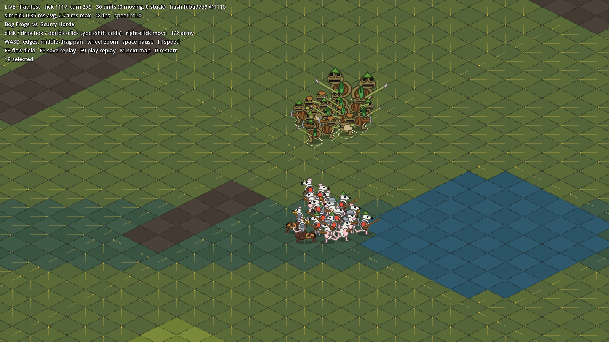

# 2026-10-11: Map and movement, and the game goes isometric

**Milestone:** 2 (map + movement): done
**Who:** Dominic + Claude (Claude Code)

## What happened

This started late on the 10th, right after the sim core. Dominic wanted box selection before
moving on, then decided to roll it into milestone 2, which already had it. Claude proposed a
plan. Dominic picked **isometric now** and **maps stay JSON**, and asked for **one markdown file
per milestone**. Those now live in `docs/milestones/`, and milestone 2's plan and checklist were
written there before the code.

Built in this order:
1. **Terrain as data.** `data/terrain.json` (grass, swamp, reeds, rock, water). Maps became
   `aow.map/2` with a legend. `flat_test` gained a swamp band, reed clumps and a pond, and a new
   `choke_test` is one wall with a 2-tile gap.
2. **Flow fields** (`src/sim/flow.gd`). Integer Dijkstra with a bucket queue: 10 straight,
   14 diagonal, no cutting corners. The first version took 2.7 ms per 64x64 solve, and typing
   the loop variable brought it to 2.4 ms.
3. **Steering.** Units aim at the furthest clear cell a few steps down the field, or straight at
   the target when it's in view. Each MOVE is a group; units settle when they bump an arrived
   groupmate. Separation now also keeps bodies off blocked tiles.
4. **Spikes.** Five groups ordered to five spots in one turn meant five solves in one tick:
   15 ms. Now at most one solve runs per tick from a queue, and units head straight until
   theirs is ready. That made "which fields exist" part of the sim state, so it went into the
   hash.
5. **The isometric view** (`src/view/`). A 2:1 projection, a TileMapLayer generated from the map
   JSON, an RTS camera (keys, screen edges, middle-drag, zoom to cursor), and selection on screen:
   click, box, double-click for the same type. F3 shows the flow field. Claude checked the input
   by pushing real mouse events through Godot: the box catches the whole army, right-click lands
   on the exact milli-tile, and zoom keeps the cursor point still to 0.00003 px.

**Exit criterion met.** 50 units in 5 groups cross the open map (72 s) and squeeze through the
2-tile gap (54 s). Nobody ends stuck, everyone ends near their own target, and they stay settled.
The 200-unit, 10-minute match still hashes identically: avg tick 1.38 ms, p99 3.86 ms (ticks
that also solve a field).

## Decisions
- D-025: one markdown file per milestone (Dominic)
- D-026: isometric view now (Dominic)
- D-027: maps stay JSON, the view generates tiles (Dominic)
- D-028: selection is view-side, in screen space
- D-029: flow field + waypoint steering + move groups
- D-030: at most one field solve per tick; the field set is hashed state

## Direction changes
- The MVP plan said to paint maps as TileMapLayers and bake the sim grid from them. Now JSON is
  the source and the TileMapLayer is just its picture (mods stay script-free).
- The MVP plan said box select would query the sim's spatial hash. It's view-side now, because
  in isometric a screen box is a diamond in sim space, and "what you see" is what matters.
- Isometric moved from the art pass to now.

## Pictures

## Funny moments and bugs worth remembering
- **The bulldozer.** The first chokepoint run left four frogs 4-5 tiles past their target. They
  had arrived first and settled, and then the next four groups marched straight through them and
  carried them along. Fix: settled units that get shoved well off their spot walk back.
- **Box select caught 11 of 18.** That wasn't a bug in the box: the frogs had just spawned and
  were still spreading apart while the test was dragging. Pausing the sim for the drag gave 18/18.
- **"Target is wrong!"** It wasn't: the test looked before the MOVE's two-turn delay had passed.
  Lockstep teaches patience.
- **Tile seams.** The first isometric screenshot had a fine dark grid between every diamond. Each
  diamond now bleeds a pixel into its neighbours, with nearest filtering.
- **A stray click in the archive photo.** The first archive capture showed one random rat selected
  instead of the frog army, probably from a real mouse click in the window while it was capturing.
  The screenshot script now ignores live input. The retake reached the same state hash at the
  same tick as the earlier run, so the view-driven run is deterministic too.
- GDScript can't infer types from an untyped `for c in array`. `for c: int in bucket` fixed the
  parse error and made the solver about 10% faster.

## Ideas parked
- Spread a field solve over several ticks, or move it to a GDExtension, if the 2.4 ms spike ever
  matters (backlog).
- Raised-looking rocks and reeds; sprite footprints that match collision radii (backlog).
- An in-editor map painting tool that writes the JSON (backlog).
