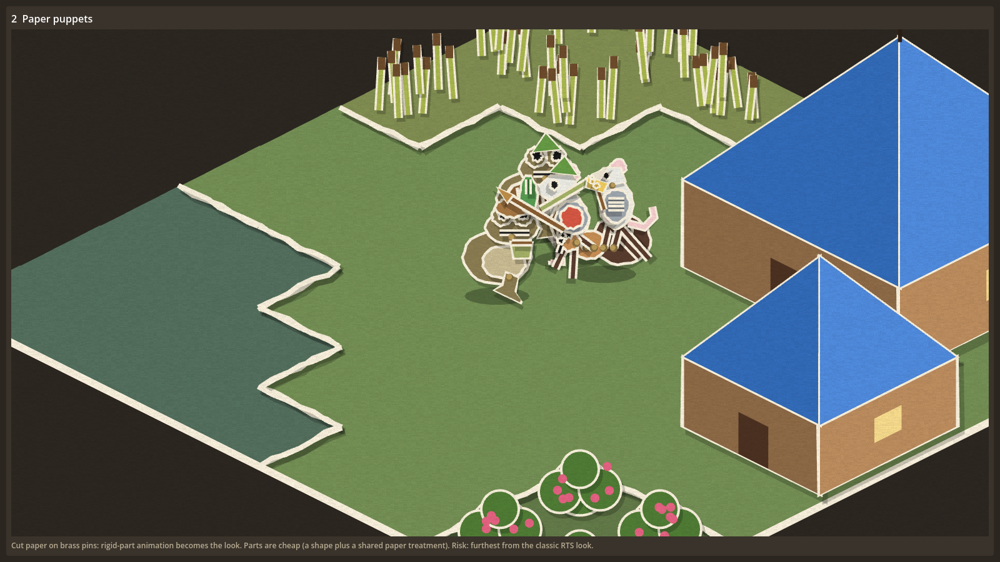

# 2026-10-11: Five ways to draw a frog

**Milestone:** art pass, step 1 (style sampler)
**Who:** Dominic + Claude (Claude Code)

## What happened

Dominic found the placeholder style "surprisingly cute" and wanted to start the art milestone.
Claude laid out five directions (storybook vector, paper puppets, painterly, pre-rendered toy
diorama, pixel art) and suggested sampling three. Dominic asked for samples of all five.

So the composer gained a drawing `style` (in `part_shape.gd`, the art pass's swap point), and
`scenes/style_sampler.tscn` shows one little scene five ways: grass, swamp, reeds, bug bushes, a
Town Center, a house, and a frog worker, a frog spear, a rat spear and a rat on a pony milling
about.
- **Storybook:** our shapes with a shade base, a lit top-left, highlights, ink lines and glinting
  eyes.
- **Paper:** rough-cut pieces with white borders and drop shadows, brass pins at the joints,
  paper grain; the ground as sheets with torn white edges where the terrain changes.
- **Painterly:** unlined shapes under a Kuwahara filter, labelled as faked.
- **Toy diorama:** real 3D. Frogs and rats built from spheres and cylinders, plastic materials,
  sun and soft shadows, SSAO, an orthographic camera at our exact 2:1 angle.
- **Pixel:** the scene rendered at a third of the size, fewer colours, nearest scaling.

All panels sit at the same in-game scale (one 2D pixel at zoom 1 matched to 3D world units),
with keys 1-5 for a 4x close-up.

## Decisions
- D-040: the art direction is open again; choose from the sampler.

## Pictures

## Funny moments and bugs worth remembering
- **The shadows were there all along.** The toy diorama had no visible shadows through three
  rounds of tweaks to shadow modes and biases. The sun was shining *away* from the camera, so
  every shadow fell neatly behind the thing casting it. Turning the sun around fixed it at once.
- **Rats with three spears.** The first 3D rat tails were straight sticks at 70 degrees and read
  as extra weapons. They're now four chained segments curling along the ground.
- **Everything on one tile edge.** The first paper ground drew a white border round every tile,
  which looked like graph paper. Paper is sheets, so edges only go where the terrain changes.
- The first framing put the 3D panel at about half the scale of the 2D ones. It's now derived
  from the projection: a tile diagonal is 32 px, and in 3D that's sqrt(2) * sin(30 degrees) units.

## Ideas parked
- Mixes: storybook units on painterly ground; toy-rendered parts with ink outlines; paper ground
  with storybook units.
