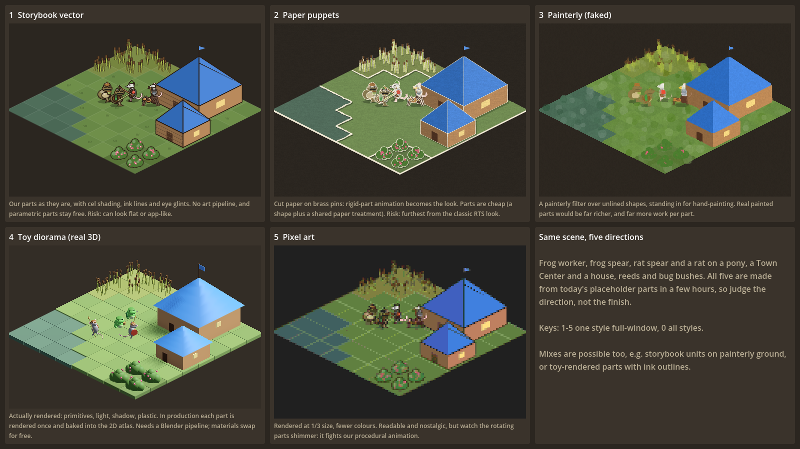
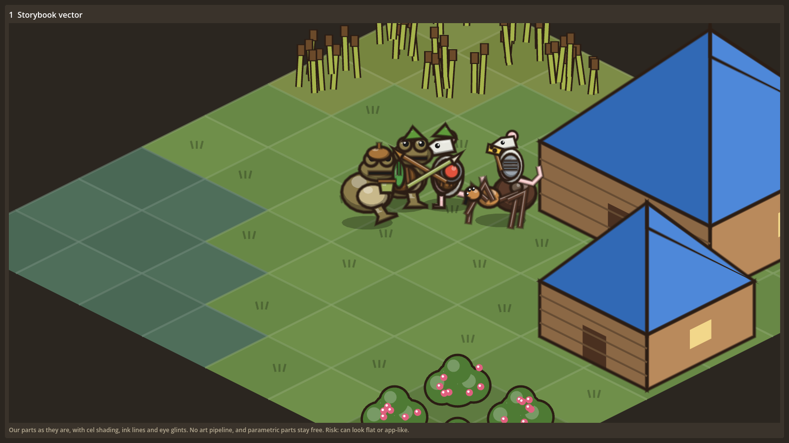
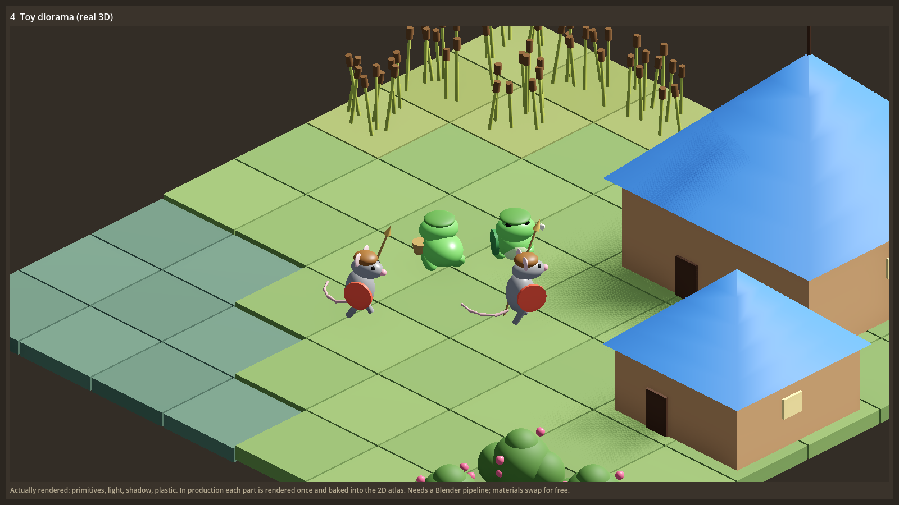
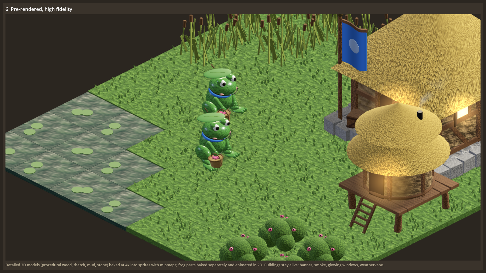
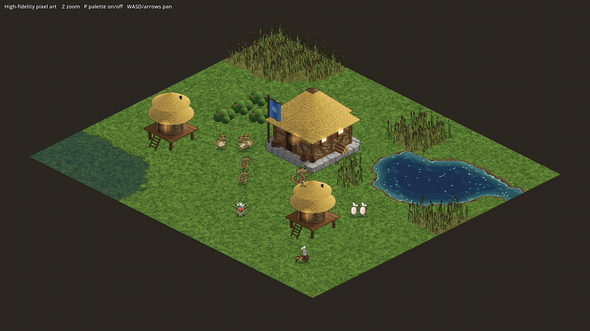

# 2026-10-11: Five ways to draw a frog

**Milestone:** art pass, step 1 (style sampler)
**Who:** Dominic + Claude (Claude Code)

## What happened

Dominic found the placeholder style "surprisingly cute" and wanted to start the art milestone.
Claude laid out five directions (storybook vector, paper puppets, painterly, pre-rendered toy
diorama, pixel art) and suggested sampling three. Dominic asked for samples of all five.

So the composer gained a drawing `style` (in `part_shape.gd`, the art pass's swap point), and
`scenes/style_sampler.tscn` shows one little scene five ways: grass, swamp, reeds, bug bushes, a
Town Center, a house, and a frog worker, a frog spear, a rat spear and a rat on a pony milling
about.
- **Storybook:** our shapes with a shade base, a lit top-left, highlights, ink lines and glinting
  eyes.
- **Paper:** rough-cut pieces with white borders and drop shadows, brass pins at the joints,
  paper grain; the ground as sheets with torn white edges where the terrain changes.
- **Painterly:** unlined shapes under a Kuwahara filter, labelled as faked.
- **Toy diorama:** real 3D. Frogs and rats built from spheres and cylinders, plastic materials,
  sun and soft shadows, SSAO, an orthographic camera at our exact 2:1 angle.
- **Pixel:** the scene rendered at a third of the size, fewer colours, nearest scaling.

All panels sit at the same in-game scale (one 2D pixel at zoom 1 matched to 3D world units),
with keys 1-5 for a 4x close-up.

### Then: detail, and a sixth direction

Dominic pointed out the important miss: the five panels varied the *rendering* of one
placeholder frog, not the art direction or the level of detail. He placed the classic RTS look
"somewhere between toy and pixel", said we hadn't tried higher fidelity, said buildings can
carry a lot because they're static, and then corrected himself: "more or less static, I'd
rather aim for a little bit of life to them".

So Claude built a sixth panel as a real pipeline prototype, not a mock-up: procedural PBR
materials, detailed 3D models (a frog Town Center with stone footing, timber frame, stepped
thatch, chimney, barrels, crate and woodpile; a stilt hut with a ladder; reeds, bug bushes and
tiles; a frog worker in six parts), and a baker that renders them at 4x into mipmapped
sprites. The 2D scene is built only from baked sprites. Buildings get life from live parts:
a banner waving through a shader, chimney smoke, flickering windows and a lantern, and a
dragonfly weathervane. Frog parts are baked with their pivots and walk with our 2D animation.

### Then: back to pixels, keeping the frogs

Dominic's verdict on the high-fidelity panel: we'd lost something the original and the pixel
art had. The 3D frog was a *different character*, so the frog people lost their whole feel. The
physically-based light went "a level too far, into uncanny valley": in the classic games you
never think about the lighting, because they're pixel games. He asked for high-fidelity *pixel
art* instead, with the presentation done properly: no grid, round water, the classic genre
in mind.

So Claude kept the characters exactly and changed only how they're made. Every 2D part becomes
simple lit 3D automatically (ellipses inflate, polygons get a bevel-ish tilt, lines become
rods), drawn in the original 2D order, baked at 4x and pixelized with a darker inner outline.
`UnitView` draws those sprites through a new "baked" `PartShape` style, so sockets, animation
and mounts didn't change at all. The step 1b buildings came back matte and pixelized with
baked ground shadows. The ground is one shader driven by blurred terrain masks (rounded
shorelines, a mud bank, foam, sparkles), and the whole frame goes through one palette with a
light ordered dither, at 2x nearest.

## Decisions
- D-040: the art direction is open again; choose from the sampler.
- D-041: a sixth direction, high-fidelity pre-rendered, built as a real bake pipeline.
- D-042: the leading candidate is high-fidelity pixel art that keeps the original characters.

## Pictures

## Funny moments and bugs worth remembering
- **Giant frogs, rats on the roof.** The first pixel bake had frogs nearly as tall as the Town
  Center walls, and the rat spearmen had wandered onto the stilt hut's thatch. Units now sit at
  70% scale, baked at that size, with their wander areas on open grass.
- **Uncanny valley, in a frog game.** Lesson from Dominic: fidelity isn't realism. The classic
  look is detailed *pixels*, not physically-based light.
- **The first bake was overexposed.** A key, a fill, a rim light and generous ambient light
  turned the grass mint and the thatch nearly white. The swamp read as speckled stone until it
  became dark, wet and nearly flat. The stilt-hut ladder leaned the wrong way twice (a sign error).
- **The shadows were there all along.** The toy diorama had no visible shadows through three
  rounds of tweaks to shadow modes and biases. The sun was shining *away* from the camera, so
  every shadow fell neatly behind the thing casting it. Turning the sun around fixed it at once.
- **Rats with three spears.** The first 3D rat tails were straight sticks at 70 degrees and read
  as extra weapons. They're now four chained segments curling along the ground.
- **Everything on one tile edge.** The first paper ground drew a white border round every tile,
  which looked like graph paper. Paper is sheets, so edges only go where the terrain changes.
- The first framing put the 3D panel at about half the scale of the 2D ones. It's now derived
  from the projection: a tile diagonal is 32 px, and in 3D that's sqrt(2) * sin(30 degrees) units.

## Ideas parked
- Mixes: storybook units on painterly ground; toy-rendered parts with ink outlines; paper ground
  with storybook units.
