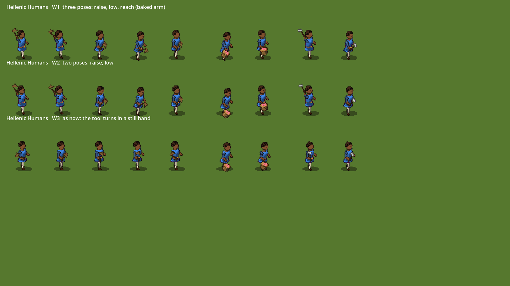
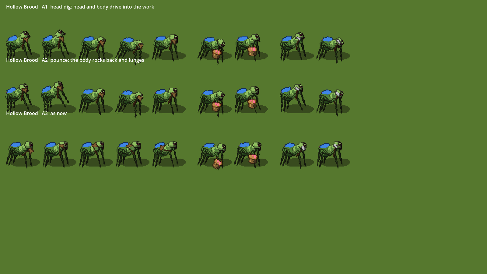

# 2026-10-12: Animation review and concepts

**Milestone:** after 11 (animation was never its own milestone)
**Who:** Dominic (the ask: "centaurs when gathering should kneel with front legs, but I'm sure
there's lots more; list findings before doing anything") + Claude (Claude Code)

## What happened
A review of how units move, from the code and four contact sheets (`tests/art_anim.gd`). The
rig is simple: rigid legs pivoting at the hip, the body with its arm baked in one fixed hold
pose, only the tool turning in the hand. So work is almost invisible for every race (a few
degrees of lean, the tool rotating), the animal half of centaurs and mounts does nothing,
armless creatures barely work at all, attacks are a weapon twitch, deaths a cardboard topple,
and walking a stiff rock. Idle fidgets, the frog hop, flyers' flapping and the 8-facing
snapping are fine.

Then concepts (D-080: options at game scale, Dominic picks, then build). Three questions,
three options each, rendered through the real rig and bakes by `tests/anim_concept_sheet.gd`:

- **Workers' arms:** W1 three baked arm poses (raise, low, reach) swapped through the work
  cycle; W2 two (raise, low); W3 as now. The poses are two new holds in `unit_models.arm_pose`
  ("reach", "raise") that the game never asks for yet; `UnitView.set_hold()` swaps the body's
  bake and moves the tool to the new hand.
- **Centaurs (and mounts) at work:** C1 kneel (front legs fold short, chest dips about the
  feet, the rider half leans in); C2 bow (the whole body pitches); C3 as now. The first kneel
  swung the front legs 77 degrees back under the belly and read as broken legs; folding them
  short with a small forward knee reads right.
- **Armless creatures (beetles, spiders):** A1 head-dig (head and body drive into the work);
  A2 pounce (the body rocks back and lunges); A3 as now.

Attack step-ins and deaths per body shape wait for the next round. Nothing here is in play:
the concept hooks (`UnitView.concept`, `set_hold`) only run when a sheet sets them.

## Decisions
- None yet: Dominic's pick is pending (then a D-number).

## Pictures

## Funny moments and bugs worth remembering
- Four Godot windows baking at once starved Dominic's running game of the GPU ("running game
  stopped btw"). One capture at a time from now on, headless where possible.
- The first concept sheet "hung": it was baking every age of every unit line of five races,
  which takes minutes. Workers only, and it takes one.

## Ideas parked
- Attack: a step-in and body lean, a draw-to-release swap for archers. Deaths: quadrupeds
  collapse down, bipeds topple, flyers drop first. Dust at building sites. (Next concept round.)
