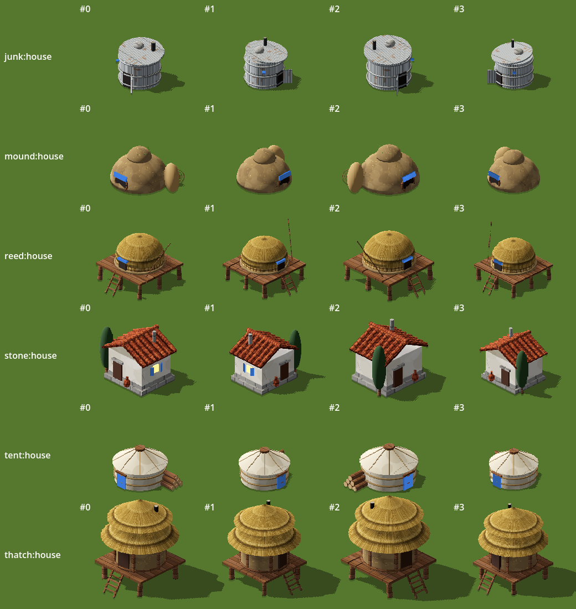
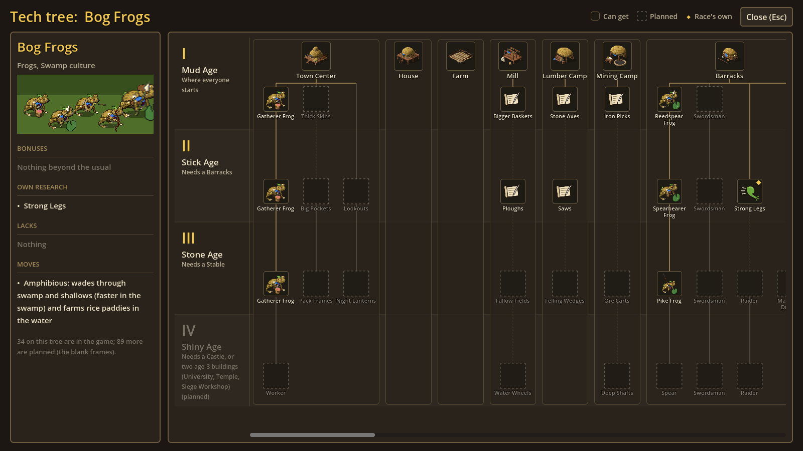
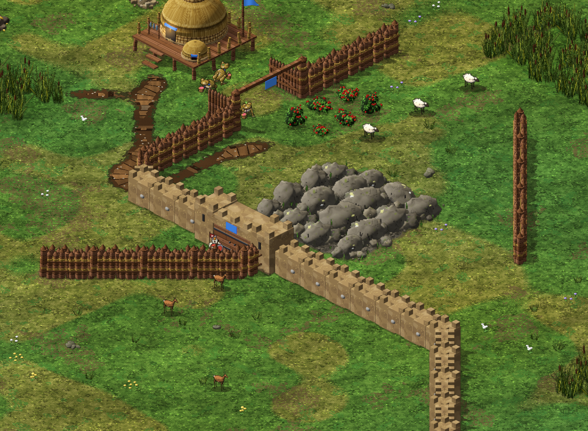
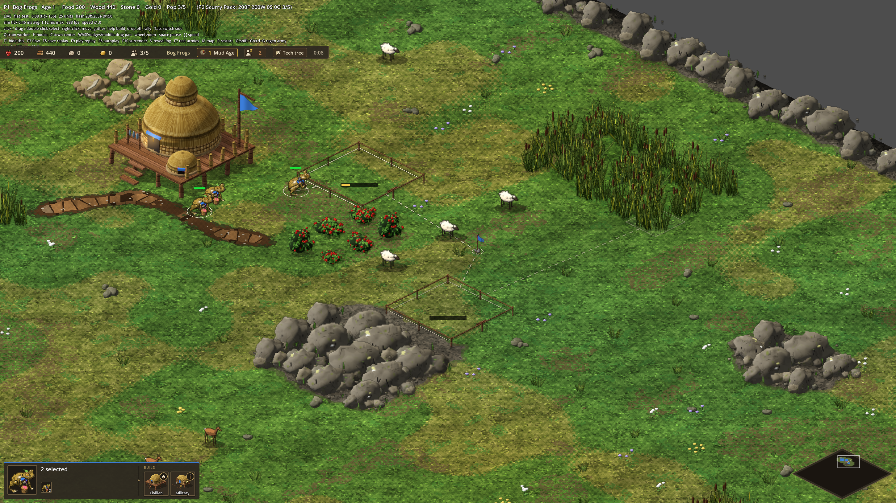
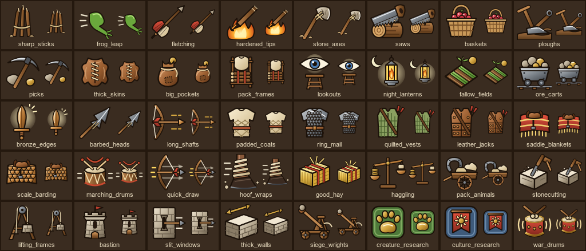
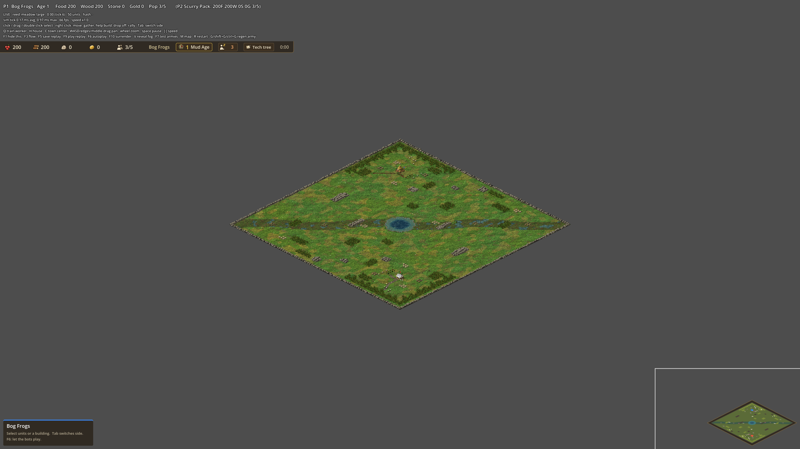

# 2026-10-12: Many hands

**Milestone:** 12 (the full land tech tree), with 13-19 planned
**Who:** Dominic + Claude (Claude Code, with parallel agents in worktrees)

## What happened
Dominic played and sent notes faster than one session could work, so Claude split the work
among agents, each in its own git worktree, and merged their branches into main as they
finished (resolving the clashes: two agents' gates and the tech tree both wanted `palisade`;
the walls agent changed every footprint to sx x sy under everyone else's code). Over the day:
the tech tree page (F2, and from the lobby), walls and 3-tile gates, stances, the research
queue, waypoint routes, fog memory, one farmer per farm, a healer, research effects and 38
icons, two sizes of Reed Meadow with resources for a long game, and the lobby's dice. Dominic
cut age 4 and the Temple, then asked that nothing be thrown away, so they were parked whole.
Milestones 13 to 19 were planned from a long design talk (sieges, maps, heroes, living towns,
match rules, a real UI).

## Decisions
- D-108 playtest fixes; D-109 walls and gates; D-110 three ages, healer; D-111 research effects;
  D-112 Reed Meadow sizes; D-113 milestones 13-19; D-114 the dice; D-115 "Age of Anything".

## Direction changes
- Four ages -> three (age 4 parked, may come back).
- Mystics at a Temple -> a healer at the Town Center.
- "Build roads" -> paths that come for free and trails that wear in.
- Race bonuses from creature and culture -> mixed from group, creature and culture.
- "Age of Whatever" -> "Age of Anything".

## Pictures

## Funny moments and bugs worth remembering
- Watchtowers had been shooting all along; nobody could see the arrows.
- Crossbows crept forward a step after every shot: their attack-move kept calling them home,
  and home was past the enemy.
- Bushes held 2,000 food each, so nobody ever needed a farm; the bot then built one farm per
  food worker and spent all its wood on fields, sitting on 3,500 food in the Mud Age.
- A wall of "material is null" errors turned out to be the armour's cut-out colour, not the
  armour.

## Ideas parked
- Battle mode (backlog); morale and weather kept light or cosmetic; a campaign later.
