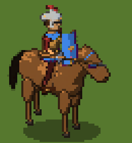
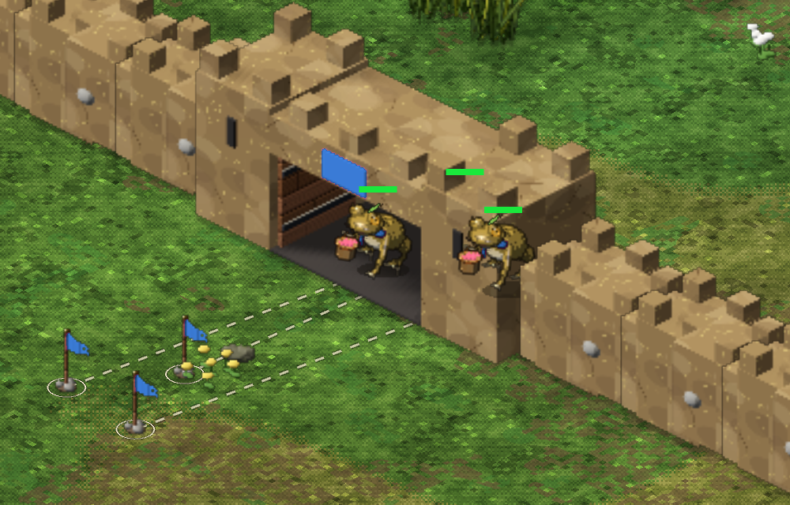
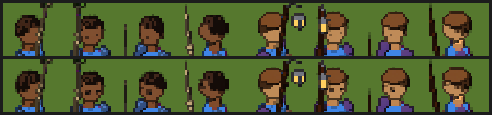
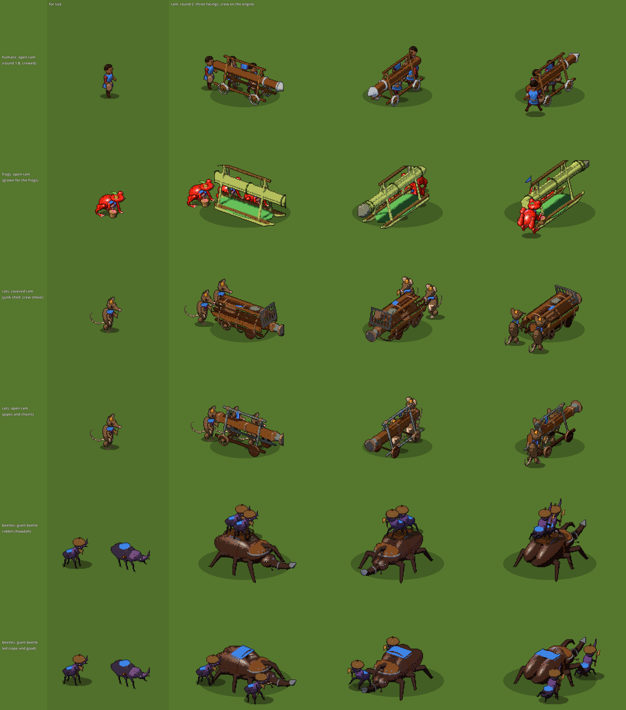
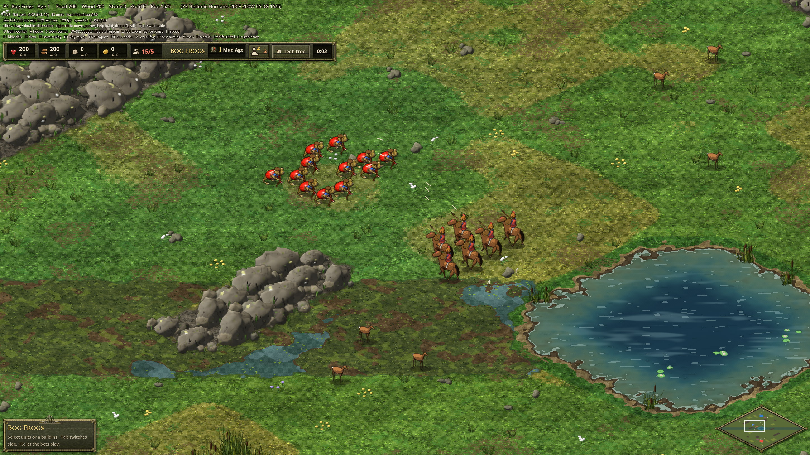

# 2026-10-13: Siege and crews

**Milestones:** 12 and 15 closed for now, 17 done, 13 started (siege first)
**Who:** Dominic + Claude (Claude Code, with parallel agents in worktrees)

## What happened
Dominic kept playing and sending notes; Claude fixed the small ones directly and gave the bigger ones
to agents in their own worktrees, merging each as it finished.

- Small fixes: riders' legs reach down the horse's flank ("tiny legs"); the command panel back to one
  row (how-to lines moved to a hover tip); the pilum raised to throw instead of held like a rifle; the
  Town Center's bell rings and unrings (a second press sends everyone back to work); units no longer
  chase foes their side can't see; cost rows shrink to fit the Wonder's four costs.
- Faces: bigger eyes and dark brows standing just off the brow ridge (a tiny eye dot "looks creepy").
  Eye whites were tried and turned into a single white pixel, creepier still. Then the "hairline" band:
  it wasn't hair at all but the leather cap's darker brim lying across the brows; the cap now sits higher.
- Double-click a building to select all of its kind on screen; Train spreads over the least busy.
- The stone gate: a black void with doors hidden inside and walkers vanishing under its roof; rebuilt
  as an open gateway between two arches. The AI against walls: it always came, but spread its blows
  over a dozen pieces (often a corner that opens nothing); now the army hits one piece that opens the
  way, usually the gate.
- Archers: "anyone with a collection of them wins". Weaker bows were tried first and reverted, because
  the equal-cost arena showed archers average per cost. The cause was instant, never-missing arrows:
  shots now fly and miss a target that moved (src/sim/shots.gd), and a mass-battle test was added. Massed
  archers now lose to skirmishers 10 of 10; large units still lose to them, which is a pricing problem
  (an agent is on it, with workers' prices: food only, about 50).
- Healers: no second tier, half the healing rate, and they stand still to heal.
- Siege: Dominic asked "why we not done siege yet?" Milestone 13 started with siege, concept-first. Round 1
  (two directions, five families), round 2 after his notes (crews on everything, rats human-sized, the
  forest ram a giant beetle). Picked; an agent is building them. The frogs' direction is being rethought.

## Decisions
- D-116 rats are human-sized for new art (their thimbles and bottle caps stay, "fine for now"); D-117 the
  forest ram is a giant beetle; D-118 siege engines show their crews; D-119 the picks, frogs rethought.

## Direction changes
- Rats: from tiny-scale found objects to human-sized junk for anything new.
- Siege engines: from the machine alone to the machine with its crew ("sad when games don't show them").
- Milestones 12 and 15 closed for now; 13 starts with siege rather than waiting.

## Pictures

## Funny moments
- The pilum read as a rifle; Roman skirmishers looked ready for a different century.
- The siege concepts gave the rats a pencil battering ram. Dominic: rats are human-sized.
- The "hairline" was a hat.

## Ideas parked
- A bear race after milestone 13: two legs, armoured, dignified, "the smarter version compared to rats";
  rideable for some races; polar or older bears much larger (backlog).
- A covered barrel-shed ram for the rats as a later upgrade.
