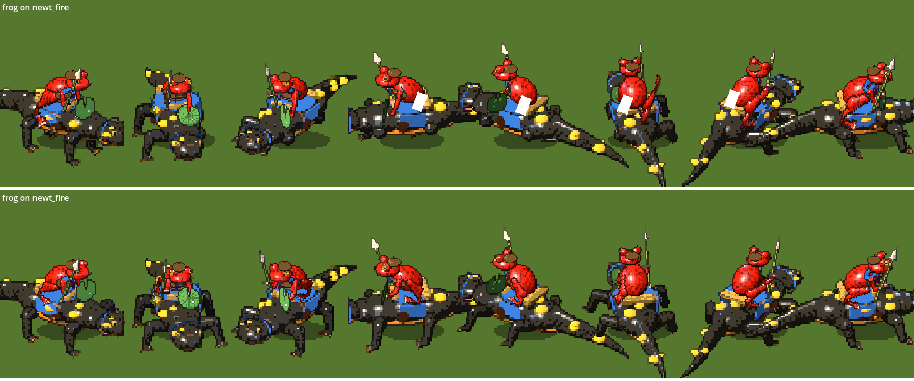
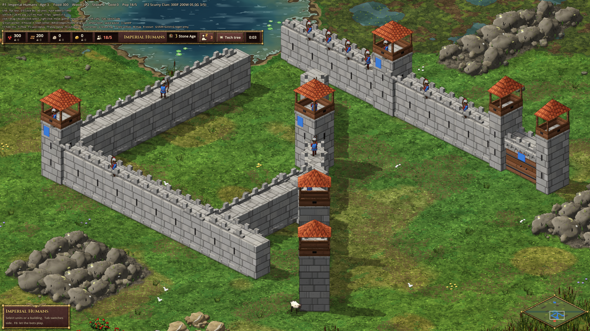
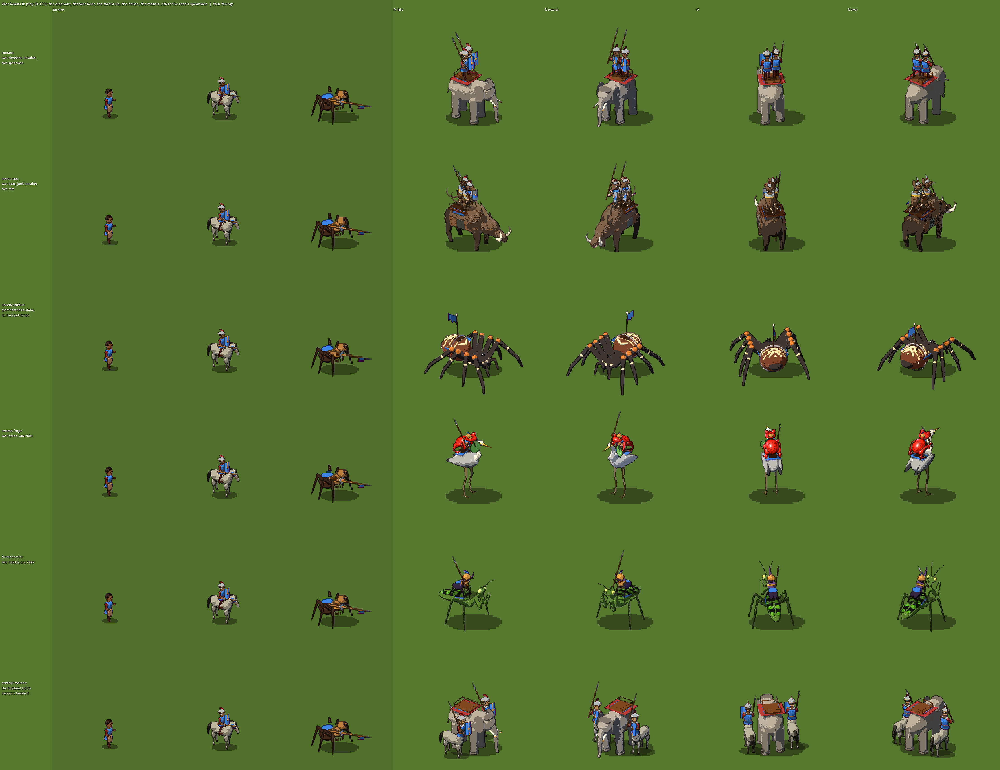
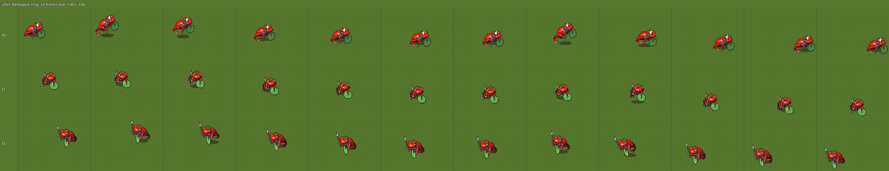

# 2026-10-13/14: Checks, walls and races

**Milestones:** 13 (unit lines) nearly done, 14 (race identity) built, 16 (sieges) first version, 21 (modability) planned
**Who:** Dominic + Claude (Claude Code, with many parallel agents in worktrees)

## What happened
A long stretch of playtest notes turned into work for parallel agents, merged into main as each finished.

- **Placement checks.** Dominic kept catching art bugs himself (newt legs on its back, then floating; rat heads ahead of
  their bodies; a rider's leg on the far side) and asked for "a testable, non-visual way to guarantee placement of
  parts". Unit work was frozen until it existed: 3D geometry checks (feet on the ground, parts on their sockets, no
  cutting through, stance), 2D checks from the sprites (feet on the ground line, visibility), every past bug as a
  fixture that must fail, then group checks for carts, crews and riders after a cat-drawn cart slipped through.
- **Faster everything.** Tests in parallel (the full AI test from 20-40 minutes to about a minute), captures in seconds,
  the sim back under 3 ms, the lobby forging only what's on screen (27 s to 3 s) after a profile found legs cut by their
  bodies baked through a per-pixel loop.
- **Unit lines.** Swordsmen (ages 1-3, Dominic's age-3 picks), scouts, horse archers, 17 castle unique-unit themes,
  trade carts pulled by each race's beast (a snail for frogs), rats pushing barrows home with stone and gold, war beasts
  (elephant, war boar, tarantula, heron, mantis), the siege-weight great sling, proper siege shots. The sapper was built
  and then parked ("not needed"); raiders became a unique-unit theme.
- **Creatures and art.** Rats ride cats (with a real cat walk and a sit), frogs ride newts, beetles never ride horses,
  a sculpted horse head, the creature kit and one concept-sheet tool, bears in three rounds (concepts only), frogs that
  hop instead of gliding, faces with brows.
- **Race identity.** Six bonuses per race (group, creature, culture, a team bonus), own research, lacks, the spiders'
  web as the first ability; race balance from 0-90% win rates to 33-68%.
- **Sieges.** Walls you stand on, gatehouses and wall towers, breaches and repair, ladders and siege towers, defenders'
  pours, the Fortress and Siege modes on Siege Vale (with races that lack walls getting them there), then the tall walls
  at 80% with the gatehouse built into the wall and each culture's materials.
- **Maps and economy.** More stone for castles (the bots' market was selling it), Old Forest opened from 53% to 40%
  trees, workers costing food, soldiers at about 1.7x, organised gathering spots for food and wood.
- **Modding.** Milestone 21 planned, a mod loader, a sci-fi example mod (parked: Dominic wanted a wholly new race with
  lasers only), a private fan test kept outside the repo, a make-mod skill.

## Decisions
- D-116 to D-131 (rats human-sized; crews on engines; the frogs' swamp beasts; snail catapult and newts; pricing; the
  sapper parked; rats ride cats; tall walls; the sci-fi mod parked; picks from the concept rounds).

## Direction changes
- Art is checked by tools before anyone looks at it; Dominic shouldn't be the layering test.
- Test in batches after a set of changes, not after every one.
- Walls: from thin early-genre walls to tall curtains, scaled down, with real gatehouses.
- Races: from three small bonuses to six, the genre's "same tree, real flavour".

## Pictures

## Funny moments
- The "same race" bug: the enemy wasn't the same race; Dominic's own poison-red frogs were the red team's colour.
- The "hairline" was a hat; the capybara looked like a bear; spiders rode spiders.

## Ideas parked
- Heroes: built far on branch `worktree-agent-a9d1dff318f813a60` (WIP), paused; what's left is in m14 step 9.
- The sci-fi mod as an optional future age; a wholly new laser-only race when it returns.
- Regicide (lose the hero, lose the match) for milestone 18.
