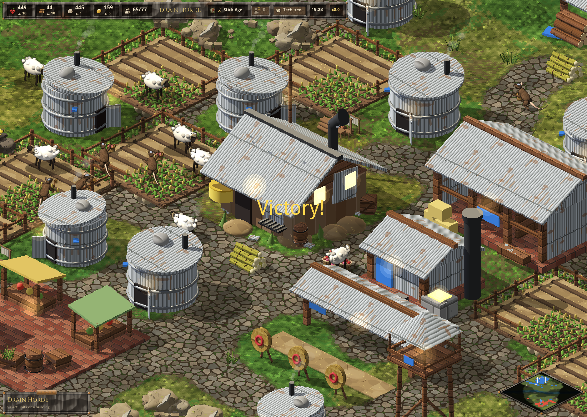

# 2026-11-03: Bots press home a lead

**Milestone:** 22 (battle feel) / the bots
**Who:** Dominic + Claude (Claude Code)

## What happened
test_ai's bot against bot (frogs against rats) had no winner by 30:00, nor by 45:00, with the rats far ahead (49
workers in age 3 against 21 in age 2). Dominic: equal bots standing off is fine, a bot with a big lead that doesn't
finish is not.

Claude gave the bot a "press" mode (D-198, `military.press` in `data/ai.json`, by level): it notices it's clearly
ahead (age, workers as it knows them, army against what it remembers), masses an army, sends all of it at the Town
Centers with its rams, reinforces, and only regroups when it's down to 30%.

Getting there, the per-minute timeline showed the massing army wasn't growing: the rats were losing a soldier or so a
minute while "massing at home". Counting deaths by where they fell showed nearly all of them died at the frogs' town:
the answer to raids sent soldiers at a frog tower that had shot a far gatherer, and after frog raiders running home.
Massing now keeps them home. A second bug: right after the push went out, the first regroup beat counted only soldiers
already 20 tiles out, found too few and called the army straight home; the push now counts its whole army.

## Results (flat_test, test_ai)
| match | before | after |
|---|---|---|
| bot vs bot (frogs, rats) | no winner at 30:00 | rats win 20:56 (clearly ahead from 13:00) |
| Hard rats vs Normal frogs | 24:09 | 19:09 |
| centaurs vs frogs | 25:30 | 30:06 (clearly ahead only from 25:00) |
| rats vs centaurs | centaurs 16:56 | centaurs 17:45 |
| watched match, rats vs frogs, reed meadow | (not run) | rats win 19:28 |

The full test_ai passes (139 checks), the quick one (96), test_2v2 (ends 27:35), test_sim's match and save parts.

## Decisions
- D-198: a bot clearly ahead presses home its lead; the test asks a clear leader to win within 12 minutes.

## Pictures

## Funny moments and bugs worth remembering
- The "massing" army was dying in the enemy's town: every time a frog tower plinked a rat far out gathering, the rats
  marched their reserve into its arrows.
- The first push came home within five seconds of leaving, because nobody had got far enough yet to count as "out".

## Ideas parked
- Massing is slow (8 to 9 minutes for 20 to 24 population): the bots' food is the bottleneck while gold piles up at
  `plenty` unused. A bot that trades or picks soldiers by what it has spare would mass faster.
- The house rule counts only the Town Center's queue; soldiers queued elsewhere can hit the cap.
