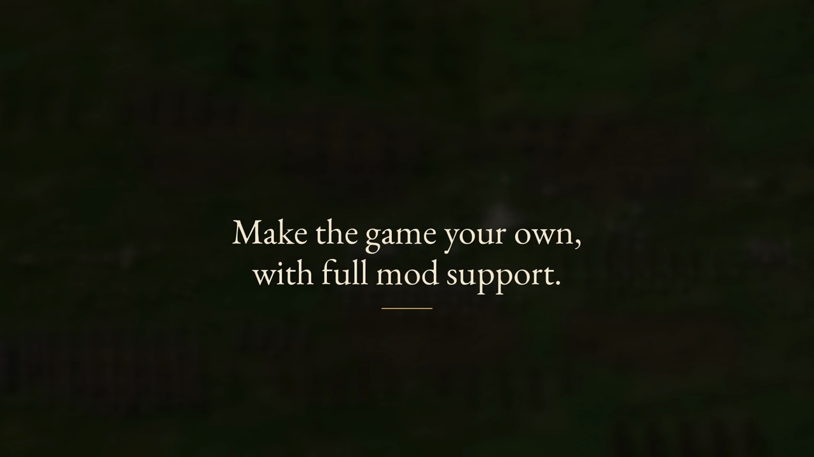
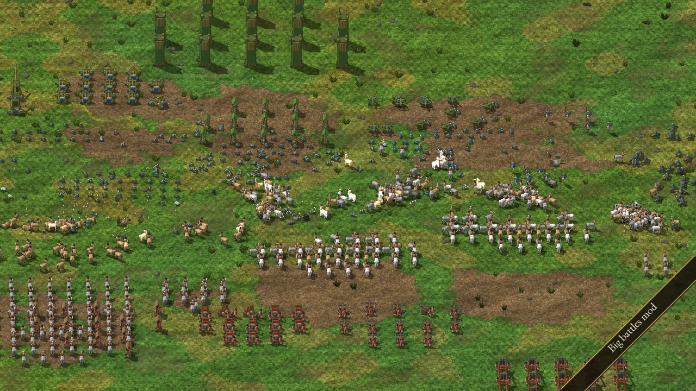
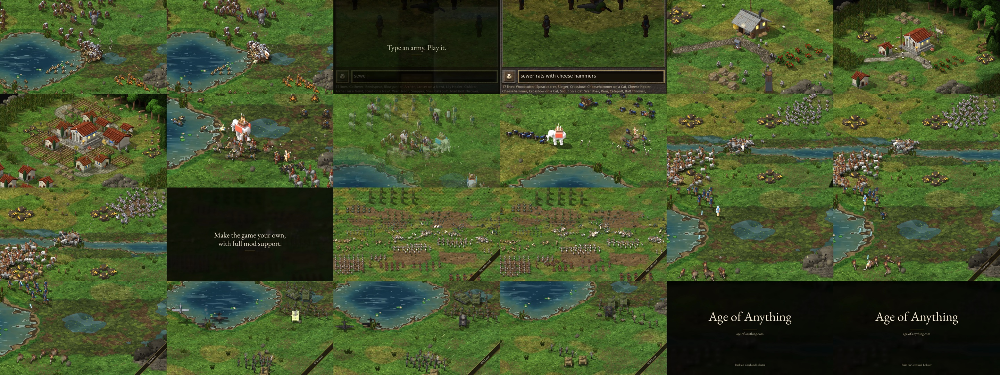
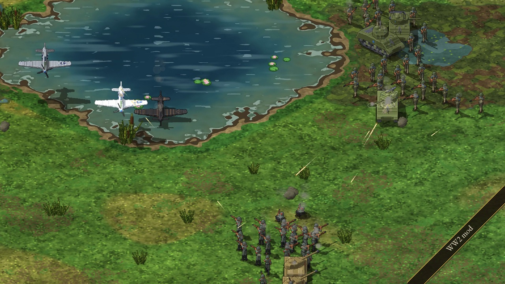

# 2026-11-07: The demo video, redesigned from scratch

**Milestone:** the website's demo video (#159, #267, #277)
**Who:** Dominic + Claude (Claude Code, Fable)

## What happened
Dominic watched the first demo cut (v9, 90 s) and called it cheap: "like a school kid's video presentation", over-compressed, lowercase labels in a UI font over long static shots, a caption box with the text not even centred. He asked for another agent to review it and then for a redesign from scratch, keeping the same content sections.

The review (an independent Claude) measured the old cut at 1.34 Mbit/s, 1280x800, with about 10 s of black and a space fight the future side lost. The redesign: about a minute, 1920x1080 at 60 fps, nothing over the world, one slow camera move a shot, cuts on whole beats of the game's own theme (92 to the minute), three sentence-case cards in EB Garamond over darkened frames of the game, a gold-edged ribbon in the corner with only the mod's name, the score built from the theme's stems faded in one by one, mastered to -14 LUFS. Dominic on the design doc and stills: "Much better already".

The engine got what filming needed on top of `record:` (#163): `window:`, `push:`, `pan:`, `look:` winning over the follow, a wider `clean`, and typing waits in seconds (#267, PR #316). `tools/film/cut.sh` builds the whole video from `demo.shots` (#277), so a changed take means one command, not an edit by hand.

Every take was filmed on the Mac through Remote Control, then filmed again after the unit rescale (#291) landed, then again for WW2 once the traced Sherman, Panzer and P-51 were in. The cut is 58 s.

## Decisions
- D-238: the demo video is built by a script from takes and a shot list, cut to the theme's beat, with the game's own music; no labels over the shots, no all caps, no age names.

## Direction changes
Hand-assembled cuts with captions -> a shot list and a script. Follow-camera shots -> a fixed `look:` with a push or pan; the follow sat on the middle of two fights, on a pond.

## Pictures

## Funny moments and bugs worth remembering
- The first corner ribbon read "Big" alone: the shell split the mod's name on its spaces.
- `window:1600,900` gave 2582x1800 on the Mac: the screen is 1512 points wide, so the window was capped. 1280,720 gives true 16:9 at 2560x1440.
- A one-frame ribbon faded in at 0.3 s and never appeared: the fade ran on a single frame at t=0.
- "mud peasants" generates spiders, "sheep" bears, and "tiny romans" normal-sized humans.
- The 2,000-unit lines never met until #315; before it, footprints from #253 and the rescale had never been on the same main.
- A destroyed Sherman draws as a black box with a figure on it (#332).

## Ideas parked
- Game sound hits under the music (a charge, a tank shot, a plane) are mixed in by hand later; the cut is music only.
- The typing shot shows a random race until the prompt resolves; worth hiding or keeping as a joke, Dominic's call.
