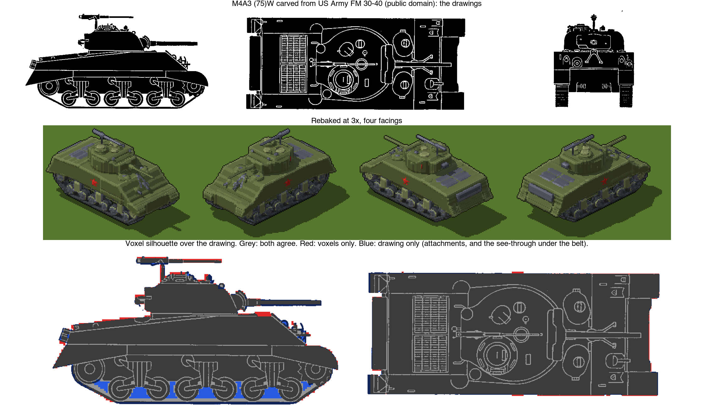
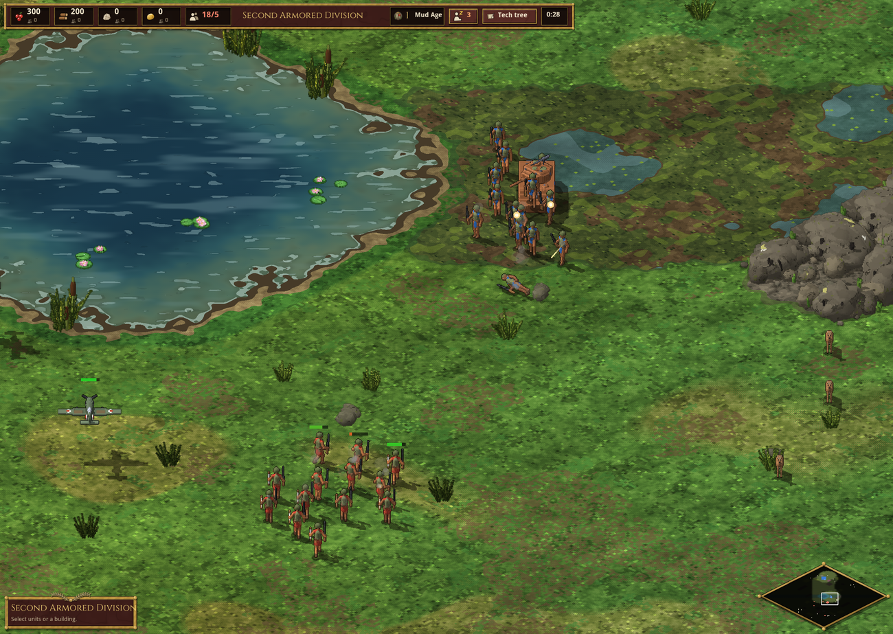

# 2026-11-07: Tracing the Sherman

**Milestone:** WW2 mod, vehicles in the engine (#176)
**Who:** Dominic + Claude (Claude Code)

## What happened
Dominic looked at the Sherman, built by eye to match the look of one, and said it was "1000000% not a sherman". First Claude wrote out a spec in metres to build to. Dominic then cut through that: on the Panzer, "i feel like you're guessing rather than just getting pictures and 1:1 drawing into voxels".

So Claude went looking for drawings. TM 9-759 has a top view of the very tank. The find was FM 30-40, a 1943 US Army recognition manual, public domain, with a labelled top, side and front plate of the M4A3 (75-mm gun), including the steep front plate and vision cupola. Its scale agreed with the published length and width to about 1%.

`src/carve.lobster` scales each view and keeps a voxel only if it's inside all three outlines. The first bake read as a Sherman straight away, before a single detail went on. Dominic: "Sherman looks great. We should record that process."

## Decisions
- D-235: real subjects are traced, not guessed

## Direction changes
We thought careful modelling plus good photos would do -> a human eye (or a Claude's) drifts into a mixture of tanks. Measuring against a drawing doesn't.

## Pictures

## Funny moments and bugs worth remembering
- The old gun stuck far past the nose. On the real tank it ends behind it (spec sheet: gun overhang 0 inches).
- In every render the new tank was perfect olive. In its first real match it was bright flesh pink-orange: an engine's `skin` is its crew's skin colour. The renders hid it because they give it no crew. Hence "play it in a match" is a step in the method.
- A thin travel lock on the nose, left in the side outline, carves into a wall the width of the tank.
- Wikimedia rate-limited us for asking too many questions about a Stahlhelm.

## Ideas parked
- `.vox` import (#24) instead of writing the volume as boxes.
- Tracing soldiers from a true three-view, if one turns up: the GI and German (#264) follow their references but aren't carved.
