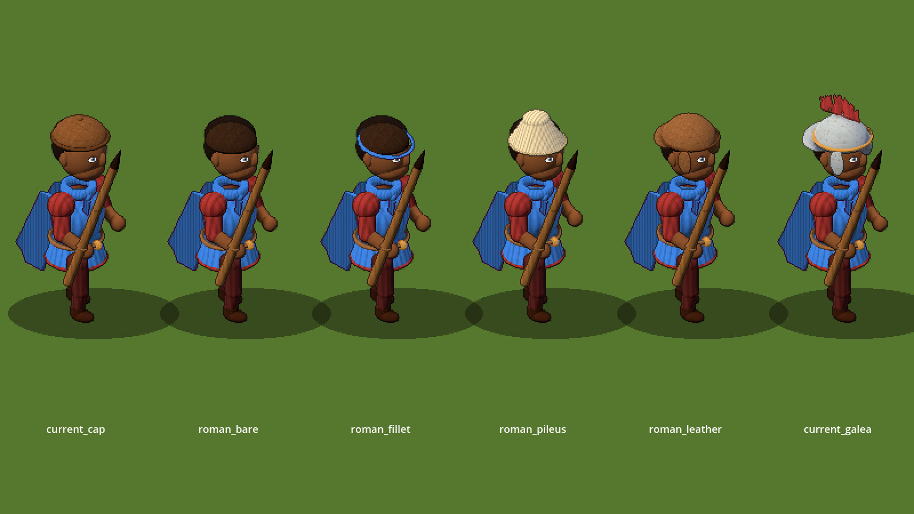
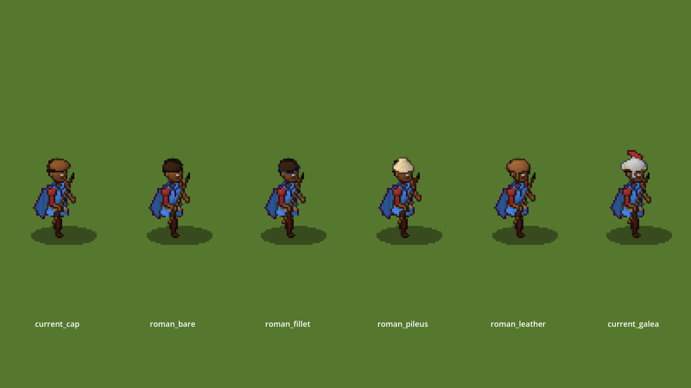
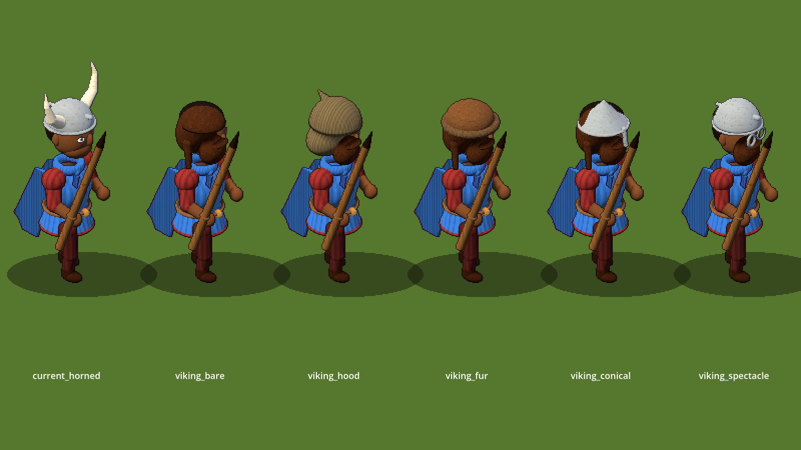
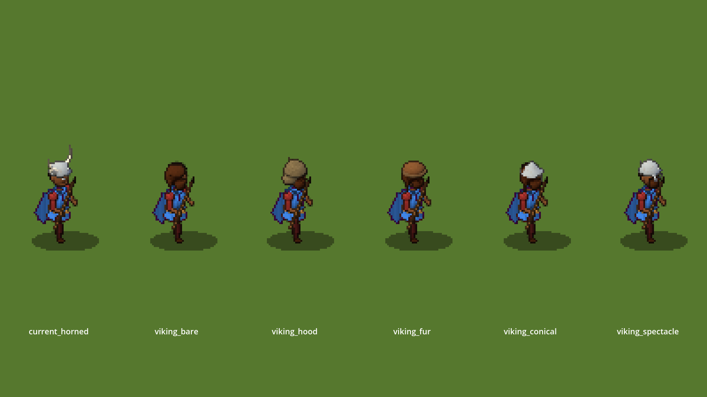
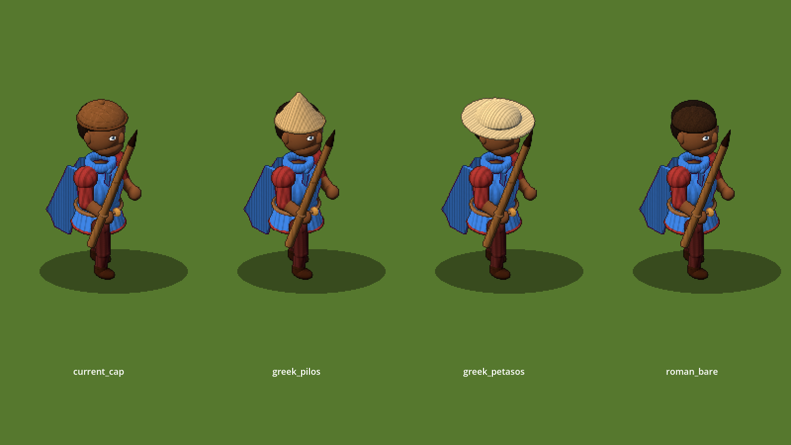
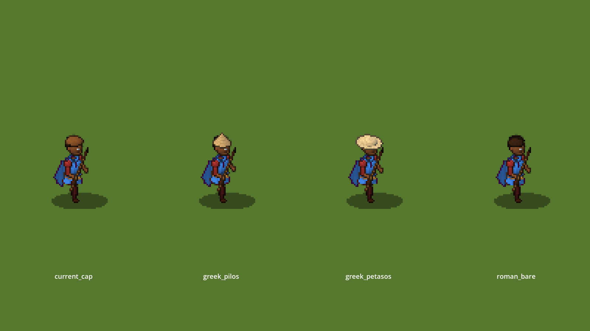

# Concept art

How unit art gets designed from now on (Dominic, 2026-10-11): **concepts first, then build.**
Instead of tweaking a model until it stops looking odd, draw several distinct variations,
compare them close up and at game scale, let Dominic pick, and only then build the pick for
the game.

Tool: `tests/concept_sheet.gd` renders candidate designs from `scenes/art_pixel/concepts.gd`
(built with the same kit as the real parts, never used in play), all worn by the same unit:

```sh
godot --path . --script res://tests/concept_sheet.gd -- out.png 5.0 2 "romans" concept.roman_bare concept.roman_pileus ...
godot --path . --script res://tests/concept_sheet.gd -- out.png 1.275 4 "romans" ...   # game scale
```

## Round 1: age-1 head gear (2026-10-11), waiting on Dominic

**The problem.** Every culture's age-1 units wore the same generic `helm.cap`: a brown lump on
Romans, Vikings and Greeks alike ("roman helmets still pretty weird, same with the vikings").

**What the sheets show.** Close up, the variations are clearly different. At game scale a head is
about 8 pixels across and a hat gets about 3 of them: the five Viking options are barely
distinguishable, and beards and braids vanish. **Head gear alone can't carry a culture at this
size.** Readable identity has to come from the big shapes: shield (Roman rectangle, Viking round,
Greek big round hoplon), cloak and tunic colour and cut, weapon, posture, and head proportions.

| Sheet | Close up | Game scale |
|---|---|---|
| Roman: current cap, bare, team fillet, felt pileus, leather cap (a galea in leather), current galea |  |  |
| Viking: current horned, bare + braids + beard, wool hood, fur cap, conical iron cap, spectacle helmet |  |  |
| Greek: current cap, felt pilos, petasos sun hat, bare |  |  |

**Questions for Dominic** (the design calls; nothing gets built until these are answered):
1. **Head size.** Keep realistic proportions (heads stay ~8 px, identity comes from shields and
   cloth), or go a little stylised with heads ~1.3x bigger so hats, helmets and beards read?
   This is the biggest single lever and changes every unit, so it comes first.
2. **Age-1 head gear per culture.** Claude's suggestion: Romans the leather cap (the galea's shape
   in leather, so age 2 reads as the same soldier promoted); Vikings bare-headed with braids and
   beard (the conical cap from age 2, the spectacle helmet at age 3); Greeks the felt pilos.
3. **Horns.** Horned helmets are the genre's shorthand for Vikings, and wrong historically.
   Keep them as the fun choice, keep them only for a "silly" ask, or drop them for the conical
   and spectacle helmets?
4. **The next concept rounds**, in order of how much they'd help readability: shield shapes per
   culture, then body and cloth silhouettes per culture, then the creature heads (frog, rat).

**Found on the way:** "vikings" currently generates a Greek race (the hellenic family): the
lexicon has no Norse family yet. That's a data gap, fixed separately from the art.
