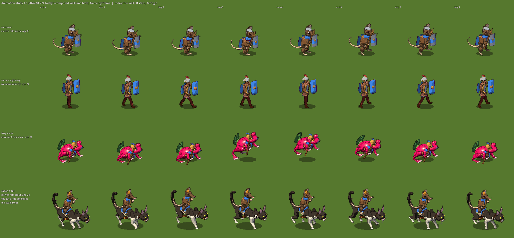
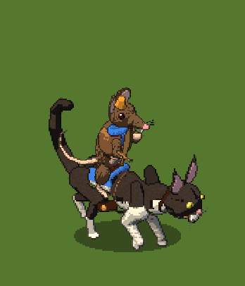
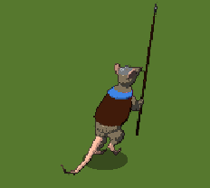
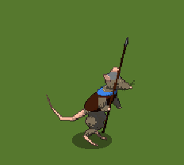

# Animation (study A2, 2026-10-27): waiting on Dominic

Dominic, watching a rat bot match in the Lobster game: "we reeeally need to improve animations. watching that rat
game was pretty lazy animations". The Lobster game composes units the way the Godot game does (its
`view/unit_view.lobster` is a port of `src/unit_view.gd`), so this study is of `UnitView`: what makes it read as lazy,
and the options. Nothing here is in the game. (An earlier round, the art-quality study's direction 3, added a
follow-through hold and 3D deaths: `docs/concepts/art-quality/`.)

## What it does today, and why it reads as lazy

A unit is a stack of baked part sprites (body with its arms, legs, head, gear) composed in 2D. Today:

| Action | What moves | What doesn't |
|---|---|---|
| Walk | each leg sprite swung like a pendulum (`sin`), the body riding on the lowest foot | knees (a leg is one stiff sprite; only cut legs with baked steps bend: the cat, war beasts), arms, head, tail, cape, weapon; the body leans by a hair |
| Blow | 0.35 s: the body lunges, the arm swaps through 2-3 baked holds (wound up, reaching), a spear thrusts | no anticipation (it starts already moving), no contact hold, no follow-through, no weight shift into the front foot |
| Work | the arm swaps between the raise and reach holds in a loop | the body and legs; the blow doesn't carry through |
| Idle | a one-pixel breath every 4 s | everything else |

 

The rat's walk is the worst case: its legs are short and swing a few degrees, and its arms, head, tail and spear are
frozen, so it glides. The legionary's legs scissor with no knees. The frog's hop is the liveliest (it was keyed:
crouch, push, tuck, reach, land). The cat already shows the better way: its legs are baked in 8 walk steps with knees
bending, and it walks properly, but the rat on it sits frozen.

## Keyed in 3D: rat B walking and thrusting

The rat Dominic picked (round F2's B, D-177), posed in 3D frame by frame (`tools/blender/concept_creatures.py ...
anim`: two-bone legs placed by where each heel is, IK for the knee) and baked by the game's own unit baker
(`tests/art_quality/anim_frames.gd`):

- **Walk, 8 frames:** each heel planted and sliding back for half the cycle, lifted and swung forward for the other
  half, knees bending; the hips lowest as the feet pass; the trunk swaying; the free arm swinging against the legs;
  the tail following the hips a beat late; the head bobbing behind the body.
- **Thrust, 6 frames:** anticipation (it sits back, the spear drawn), wound back, the lunge with the front foot
  stepping, contact at full stretch, follow-through past it, the recovery. Timed in the GIF with a hold before the
  lunge and at the follow-through.

 
 

## Options

| | What | Feel | Cost |
|---|---|---|---|
| **A. Composer polish** | no new bakes: a lean into the walk, the head bobbing a beat late, cape, tail and weapon swaying, anticipation and a contact hold in blows, a planted pause in work | a little livelier; the limbs are still stiff sprites. Squashing or turning whole sprites was already called "terrible" (round HF1), so A can't carry it alone | small, code only |
| **B. Keyed limbs, baked per body** (recommended) | every body's legs cut at the hip and baked in 8 walk steps with knees (as the cat's are now), its arms in more holds (walk swing, anticipation, contact, follow-through), its tail and head as their own cut parts in a few poses; the composer plays them as keyed cycles with A's timing on top | most of what the keyed rat shows; any creature, any gear still works (gear rides the baked hand) | per body type, shared by every unit of that creature: ~8 walk steps x legs + ~6 arm holds + tail/head poses, 8 facings each; an estimated few seconds a race on a cold start (not measured); every body's poses through the placement check |
| **C. Whole units pre-rendered** | each unit recipe posed in 3D and baked whole per frame (walk 8, blow 6, work 6, death 4...) in 8 facings: the classic pre-rendered sprite sheet | the best, every joint exact | per recipe, not per body: ~26 frames x 8 facings, ~5 s a recipe at the measured ~25 ms a render (D-165), about 3 minutes for a new race on a cold start: too slow when every prompt is a new race; gear can't swap between frames |

**Recommendation: B, with A's timing.** It follows the cat's and the war beasts' baked steps, which already work in
the game, keeps the parts kit (any creature, any gear), and costs per body type rather than per unit. C stays for
heroes or war beasts, where one recipe is seen a lot. Rat B (D-177) would be the first body built this way.
