# How far can the art go? (study AQ1, 2026-10-26)

## Dominic's feedback (2026-10-26)

> "The art is looking very interesting. To clarify unit and building fidelity is a key goal, units being more
> detailed and higher quality. Destruction looks great. FYI those laser effects weren't coming from their barrel"

- **Fidelity is a key goal.** Units and buildings more detailed and higher quality. Direction 1's
  recommendation below ("not a global 2x") is withdrawn. Next: a fidelity round, concepts that raise unit and
  building detail (2x bakes for both, finer models and textures, more poses) while keeping the genre's painted,
  chunky read, at play zoom and close up, with costs and a Steam Deck build.
- **Destruction: picked** (D-171), **go-ahead with its rules** (D-172). Dominic on the ruin: "Destroyed buildings
  should probably able to be built over? Same as [a classic RTS]. Destruction is for looking cool not game mechanic.
  Destruction staying until built over is cool but can get frustrating and ugly. I think wrong game for that". So a
  ruin is decoration only: it doesn't block or change play, you can build over it, and it fades away after a while.
- **The lasers didn't leave the barrel.** True, and not only in the concepts: the game launches every shot,
  arrows too, from the shooter's body (`sim_debug.gd`: `_body(a) - Vector2(0, 2)`). The study's three looks now
  start at each rifle's muzzle (the weapon's baked tip through its sprite's transform); pictures 12 and 13 are
  re-captured. "Today" still shows the game's own launch point. Starting the game's shots at the weapon is a
  follow-up for the game itself.

---

Dominic, 2026-10-26: "I want to explore how far we can go with art quality ... higher res, better
destruction, better animations ... sci fi mods ... lasers firing ... while maintaining nostalgia above all
else." This is a concept round (D-080): four directions, each shown in the game's own pipeline next to
what we have today, with what it would cost. **Nothing here is in the game.** The study's code lives in
`tests/art_quality/` and two flags that are off unless set (see the end).

The measure for every option is the one Dominic set: does it still feel like the classic 2D isometric RTS
you remember? Finer is not automatically better; the genre's look is chunky pixels, readable silhouettes
and painted light.

Numbers are from this Mac (M4 Max, window 2902x1632). There is no Steam Deck measurement yet: the Deck
column is an estimate, and the follow-up is a Deck build with the flag set.

---

## 1. Higher resolution

**What:** bake every unit, building, prop and the ground at more art pixels per tile, drawn at the same
size on screen. Today a tile is 96 art pixels across and, at play zoom, one art pixel is 2x2 screen pixels.
1.5x makes a tile 144 art pixels (an art pixel is 1.33 screen pixels); 2x makes it 192 (one art pixel is
one screen pixel). Same match, same camera, same zoom: `AOW_ART_SCALE=2.25` (1.5x) and `=3.0` (2x).

| | |
|---|---|
| 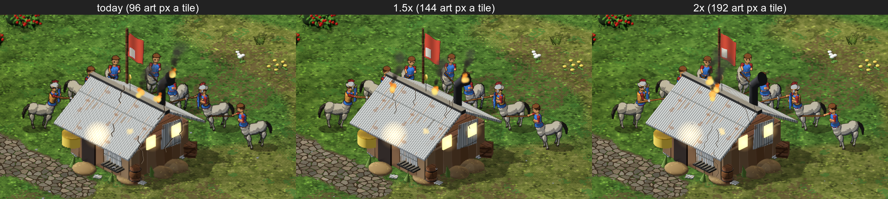 | 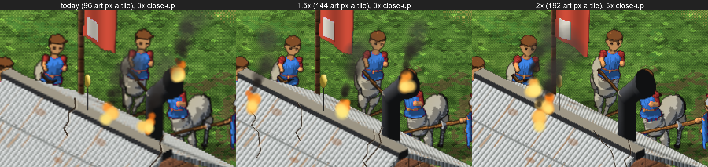 |
| 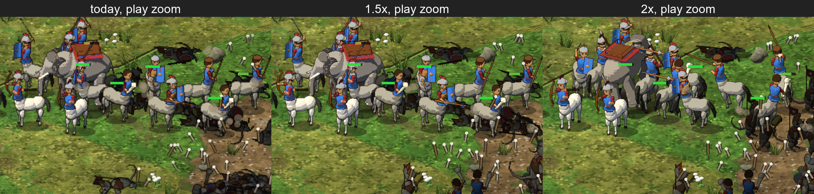 | 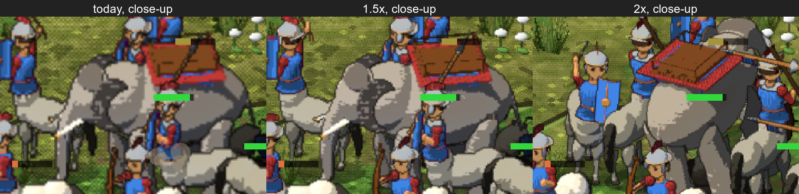 |

**What it does:** at play zoom the difference is smaller than you'd think: units gain a face, a shield
boss, the elephant's howdah gets its fringe; buildings gain their corrugation and planks. Close up (the
right column) 2x is clearly sharper. The ground gets finer too (its shader pixelates at the art scale).
The cracks and fire drawn over buildings don't change (they're drawn, not baked).

**What it costs** (two races, everything they can build, cold bake; then a battle at play zoom):

| | today | 1.5x | 2x |
|---|---|---|---|
| Cold bake (match start, nothing cached) | 21.7 s | 40.8 s | 43.3 s |
| Unit atlas | 4096 x 6009 (94 MB) | 4096 x 13265 (207 MB) | 8192 x 11405 (356 MB) |
| Video memory in the battle | 485-571 MB | 746 MB | 1175 MB |
| Frame time (Mac, battle) | no measurable difference (see [Frame time](#frame-time)) | | |
| Steam Deck (estimate) | fine | probably fine; the loader doubles | memory tight with 16 GB shared, the loader doubles, and the atlas no longer fits a 4096 texture |

- **2x broke the atlas.** At 4096 wide it would be 23178 px tall, over the 16384 a GPU takes (the game
  asserts). The study widens it to 8192 under the flag; a real 2x needs atlas pages, or units and
  buildings in separate atlases.
- **1.5x has uneven pixels.** An art pixel is 1.33 screen pixels, so some art pixels draw one screen pixel
  wide and some two: it shimmers when the camera moves. 1.5x only makes sense with a different play zoom
  (or at 1080p on a bigger monitor). 2x lands on whole pixels.
- The cold bake nearly doubles. The bake cache hides it on every match after the first, and the lobby
  warms up behind the menus (`ArtKit.warm`), so the first match after a new build is where you'd feel it.
- Every placement check, sheet and fixture measures in art pixels; they would all need a pass.

**Risk to the nostalgia:** this is the one direction that can quietly lose it. At 2x the units start to
look like small renders rather than painted sprites; the chunky read of today is part of the genre's look.
A middle way worth trying instead: keep units at today's scale and bake **buildings and props** finer
(they're big, static and where the 2x gain shows most), or bake at 2x only for a "close zoom" level.

**Recommendation (before Dominic's feedback):** not a global 2x now; try buildings-only 2x and a Deck build.
**Superseded:** Dominic made unit and building fidelity a key goal, so the next round raises both (see the top).

---

## 2. Destruction

**Today:** a damaged building gets drawn cracks from 30% damage and fire and black smoke from 60%
(`BuildingArt.set_damage`); when it falls it vanishes at once under round dust puffs (`CombatFx.collapse`),
and nothing is left.

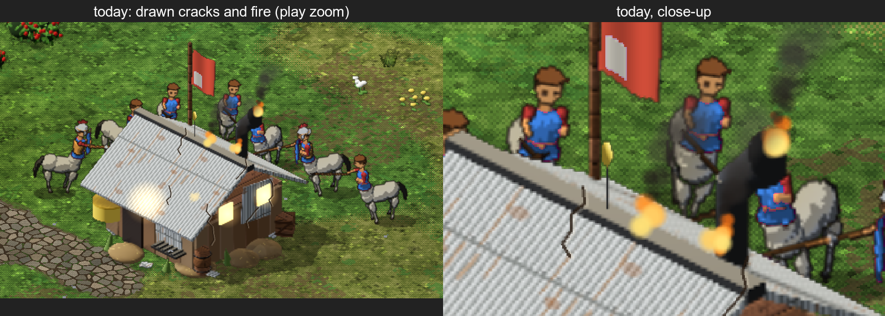

**Concept:** the building breaks up **in 3D before it bakes**, the way construction stages hold parts back
(`_hold_back`): pieces fall away from the top, others tilt and sag, some are scorched, rubble heaps up out of
its own materials, whole walls become ragged stumps with breaches, charred beams lean out. Five stages:
whole, battered, breaking, collapsed, ruin. Then the fall itself with **pixel dust** (art-pixel puffs in three
painted bands, lit from the upper left, dithered edges, thinning as it settles), and the ruin **stays**
on the map.

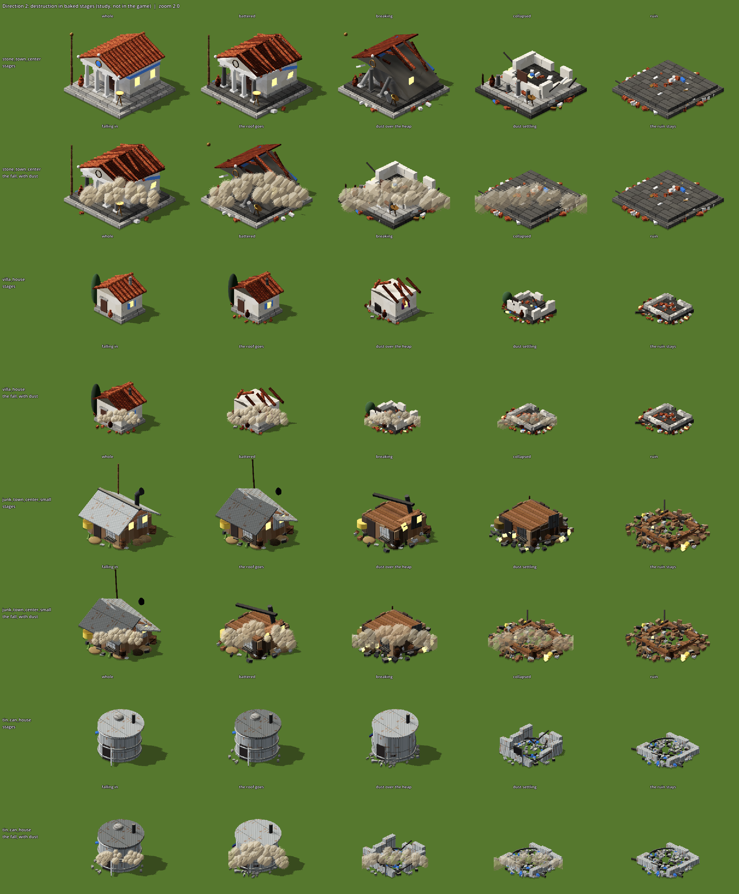

(`tests/art_quality/ruin.gd`, `ruin_sheet.gd`; the building models are untouched.)

**What it costs:** four more bakes per building look, the same again as the four construction stages
that already bake. Props and buildings take 11.2 s of a cold match start today (two cultures, stages
included), so an estimate is +4-6 s cold, nothing after the cache. Atlas: roughly +40% of the buildings'
share (not measured). Frame time: none (a stage is just a different sprite). The dust
frames are generated pictures, not particles, so cheaper than today's.

**Risks and open points:**
- The breakup is generic (it works on any model, from its pieces' sizes and heights), so some buildings
  break better than others: the villa and the junk town hall read well; the stone hall's ruin is mostly its
  big plinth, and the round tin-can house breaks into square stumps (the stumps follow a model piece's box).
  A real build would let a model name its own breakable walls.
- A ruin that stays needs a sim decision (does it block? can you build on it? how long does it stay?).
  The view could keep it as a decoration that fades after a minute or two.
- Fire and smoke over the stages would stay as today's live parts.

**Picked** by Dominic ("Destruction looks great", D-171), with a go-ahead (D-172): the ruin is decoration only, can
be built over, and fades away after a while.

**Recommendation:** yes. It's the most "classic" of the four (the genre's buildings always burned and
crumbled in stages), cheap at run time, and it reuses the construction-stage machinery. Pick a stage look,
then build it as stages 2-4 replacing the drawn cracks, keep the fire, add the ruin.

---

## 3. Better animation

**Today** (D-105, D-106): a blow is the body swapped through two baked arm holds (wound up, reaching)
with a lunge in 2D; a death turns and drops the standing sprite (a biped topples backwards). Only the frog
dies laid down in 3D (D-165).

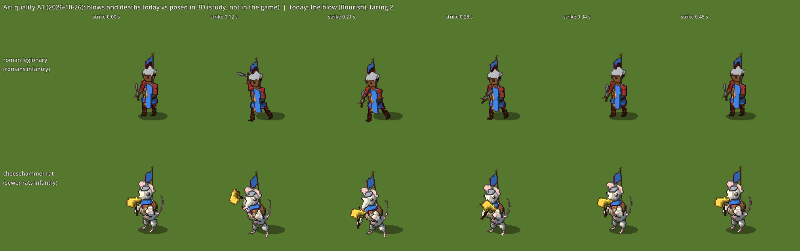
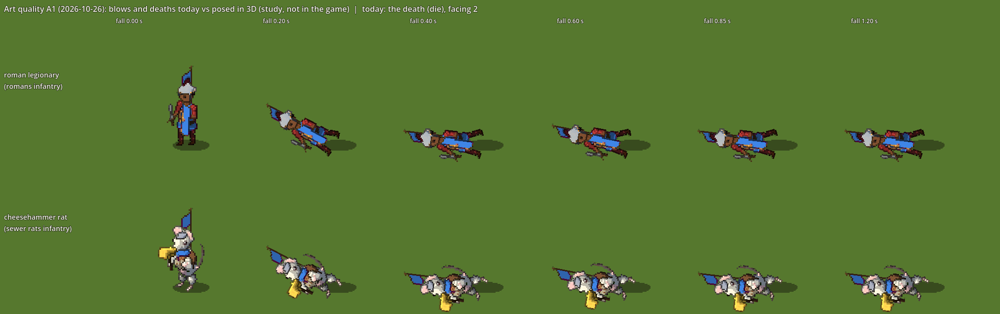

**Concept A, follow-through:** one more baked hold, `follow`: after the contact the arm carries on, low and
across the body. Wind-up, contact, follow-through, recover: five poses a blow instead of three.

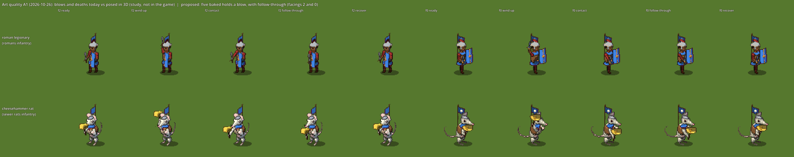

It reads well on the rat's cheese hammer (a big weapon); on a short sword at play size it's a few pixels.
Its strength would come with a weapon smear: a one-frame arc of pixels behind the blade, the genre's oldest
trick, cheap and very readable.

**Concept B, every death laid down in 3D:** the frog's corpse pipeline (rig3d, corpse.gd, D-165) given
poses for other bodies: the legionary falls on its back with its helmet rolling off; the rat falls on its
side, its cheese hammer dropped. Frame by frame, then lying dead in every facing (turned per facing for the
views that read best, D-166).

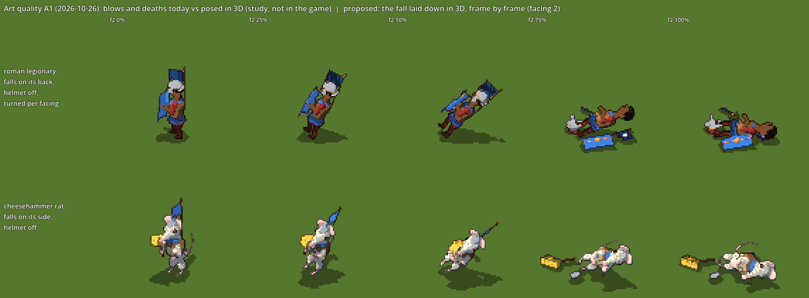
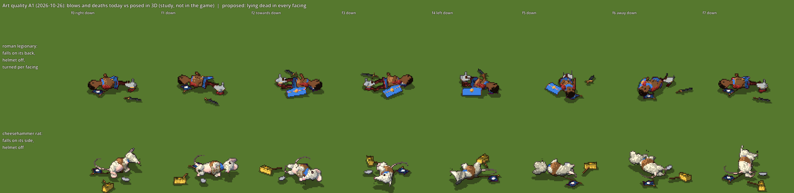

(The legionary first lay end on in facings 0-3, its feet at the camera; turned per facing, 50/70/-70 degrees
in facings 0-2, every view reads.)

Placement check: PASS for every row on both sheets (including the follow-through hold).

**What it costs:**
- Follow-through: one more body bake (8 facings) per body with arms; today's are 2-3 holds.
- Deaths in 3D: measured on the frog, ~0.6 s of renders per recipe on a cold load (D-165). For every
  recipe of two races, an estimate of a few seconds more on a cold start (bakes run six at once).
- Atlas: +25-35% of the unit share. Frame time: none.
- Each body needs its pose written (pivot, pitch, roll, leg turns, per-facing turns): a short round per
  body, checked by placement rules D1/D2.

**Recommendation:** B first (deaths in 3D for every body): it's a proven pipeline, and the falls in 2D are
the weakest frames we draw today. A second: follow-through holds plus a smear frame, as a round on heavy
weapons (hammers, axes, two-handers) where it reads.

---

## 4. Sci-fi effects (for a future mod)

A real volley in the game: the `scifi_test` mod's pulse troopers firing at charging rats, frozen with their
shots in the air, then the same shots drawn four ways (the game's effects hidden for the three concepts). The
concepts start at each rifle's muzzle (after Dominic: "those laser effects weren't coming from their barrel");
"today" leaves from the body, as the game launches every shot.

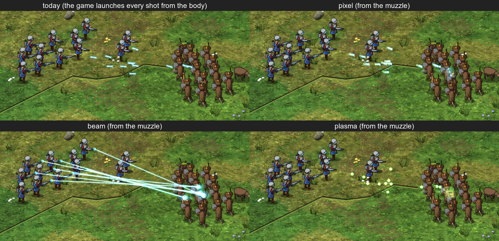
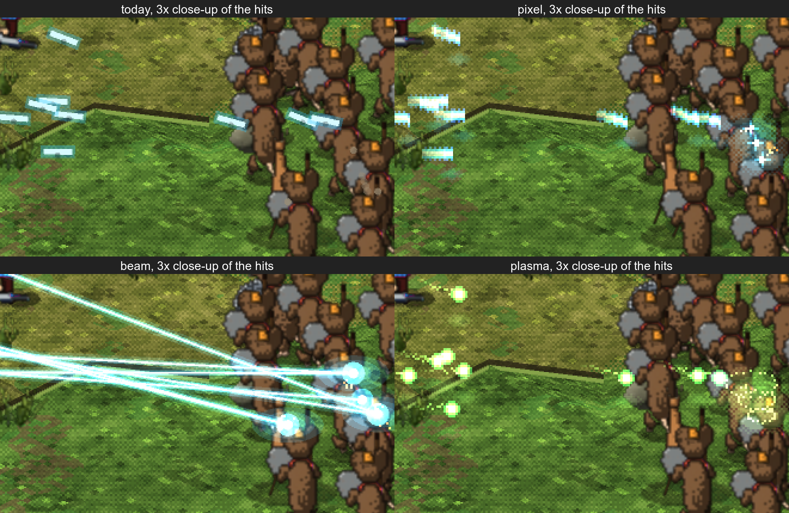

- **today:** the mod's `pulse` shot as `combat_fx` draws it (a line with a halo line).
- **pixel:** bolts drawn on the art-pixel grid in three bands (white core, cyan, dithered blue), added light;
  a pixel starburst where they hit, a dithered pool of light on the ground (and on whoever stands in it),
  scorch marks under the units with a few ember pixels.
- **beam:** unbroken lasers from muzzle to target, soft glow, flares at both ends. The most "modern".
- **plasma:** slow glowing balls with a trail of pixels, a ring splash, scorches that stay.

(`tests/art_quality/fx_study.gd`, `fx_looks.gd`.)

At play zoom the pixel bolts look close to today's in flight; their gain is the hit (a starburst and a pool of
light that lights the rat it hits). Scorch marks are under the crowd in this frame.

**What it costs:** all four are drawn per frame like today's shots: a few hundred small rects a frame in a
big fight, no bakes, no atlas. Added light is one CanvasItemMaterial in add mode. Scorch marks would join
the ground layer like worn trails. The data contract exists already (`shots.json`: `glow`, `sticks: false`);
a look would be a `style` field there, so a mod picks it.

**Risk:** beams look great on a still but fill the screen in a 60-unit fight and fight the pixel look; soft
glow is the one thing here that doesn't feel like the genre. Pixel bolts and plasma stay in the art-pixel
grid and feel like the sci-fi games of that era.

**Recommendation:** pixel bolts (and plasma for heavy weapons) as the mod's looks, beams kept for a rare
hero or super weapon if ever. Build as a `style` in `shots.json`, drawn by `combat_fx`.

---

## In short

| Direction | Nostalgia | Cost | Recommendation |
|---|---|---|---|
| 1 Higher resolution | at risk at 2x | bake ~2x, memory 2x, atlas needs pages | fidelity is a key goal (Dominic): a fidelity round next |
| 2 Destruction in stages | strong | +4-6 s cold (estimate), no frame cost | picked, go-ahead (D-171, D-172): ruins decoration only, fade |
| 3 Deaths in 3D, follow-through | strong | a few seconds cold (estimate), no frame cost | deaths yes; follow-through on heavy weapons |
| 4 Sci-fi effects | pixel: strong, beams: weak | none to speak of | pixel bolts + plasma as `shots.json` styles |

Nothing gets built before Dominic says go.

## Frame time

`tests/art_quality/frame_bench.gd`: the showcase battle (75 units) at play zoom on this Mac, 300 frames:

| | today | 2x |
|---|---|---|
| Frame | 5.3-8.3 ms (8.3 is the 120 Hz cap) | 4.1-8.3 ms |
| Render CPU | 0.37 ms | 0.41 ms |
| Draw calls | 189 | 247 |
| Video memory | 485-571 MB | 1175 MB |

The frame time doesn't move on this Mac: a sprite costs the same to draw whatever its texture's size, at the
same size on screen. (Godot's GPU timer reads 0 on Metal, so there's no GPU number.) The extra draw calls at 2x weren't
looked into. On a Steam Deck the cost is memory (16 GB shared,
the game would use about twice the video memory) and the first match's bake; the frame should hold, but
that's the one to check on the Deck.

## The study's code and flags

- `AOW_ART_SCALE=<n>` (unset: 1.5): `ArtKit.ART_SCALE` reads it; the building baker's frame grows with it;
  the bake cache keeps such bakes apart; the atlas is 8192 wide above 2.5.
- `AOW_STUDY_HOLDS=1`: bodies also bake the `follow` hold (`UnitModels.arm_pose`).
- `tests/art_quality/`: `ruin.gd` + `ruin_sheet.gd` (destruction), `fx_study.gd` + `fx_looks.gd`
  (sci-fi effects), `frame_bench.gd` (direction 1's frame cost).
- Sheet specs: `tests/sheets/art_quality_a1.json` (blows today and the follow-through, with
  `AOW_STUDY_HOLDS=1`), `art_quality_a1_death.json` (deaths in 3D).

```sh
AOW_ART_SCALE=3.0 godot --path . --audio-driver Dummy --always-on-top --script res://tests/sim_screenshot.gd -- /tmp/s.png reed_meadow siege:1800 "centaur romans" "sewer rats with cheese hammers"
godot --path . --audio-driver Dummy --always-on-top --script res://tests/art_quality/ruin_sheet.gd -- /tmp/ruin.png 2 stone_town_center villa_house junk_town_center_small tin_can_house
AOW_STUDY_HOLDS=1 godot --path . --audio-driver Dummy --always-on-top --script res://tests/sheet.gd -- tests/sheets/art_quality_a1.json /tmp/anim
godot --path . --audio-driver Dummy --always-on-top --script res://tests/sheet.gd -- tests/sheets/art_quality_a1_death.json /tmp/anim
AOW_MODS=scifi_test godot --path . --audio-driver Dummy --always-on-top --script res://tests/art_quality/fx_study.gd -- /tmp/fx
[AOW_ART_SCALE=3.0] godot --path . --audio-driver Dummy --always-on-top --script res://tests/art_quality/frame_bench.gd
```
