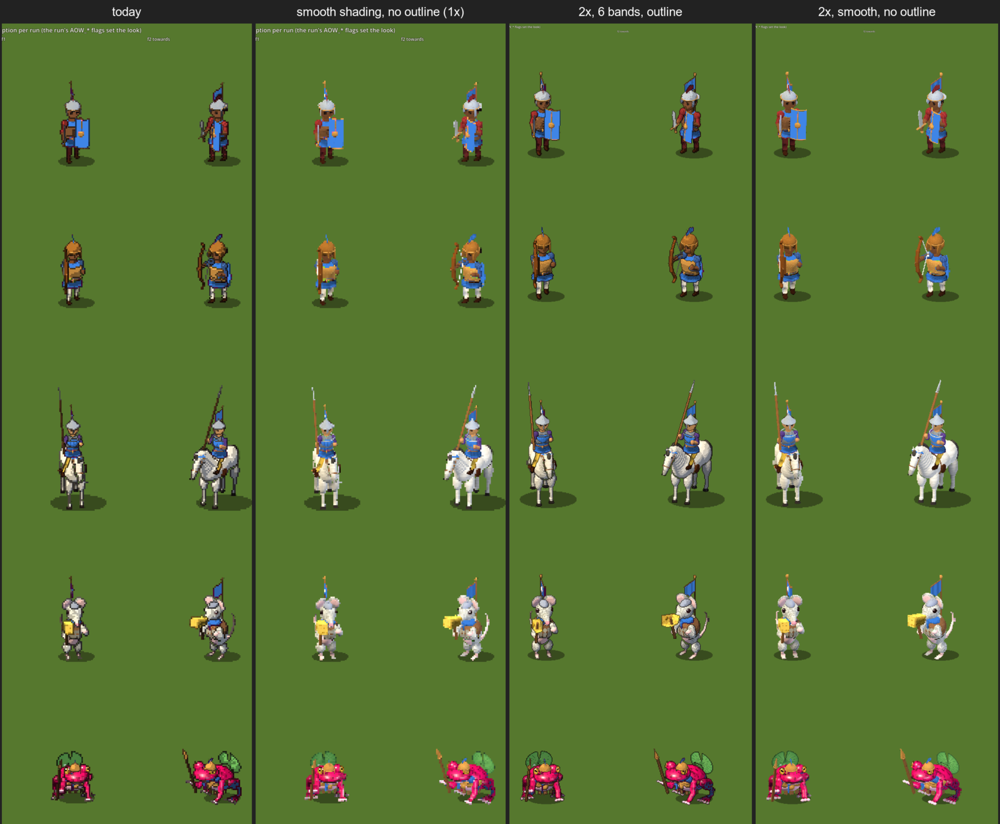
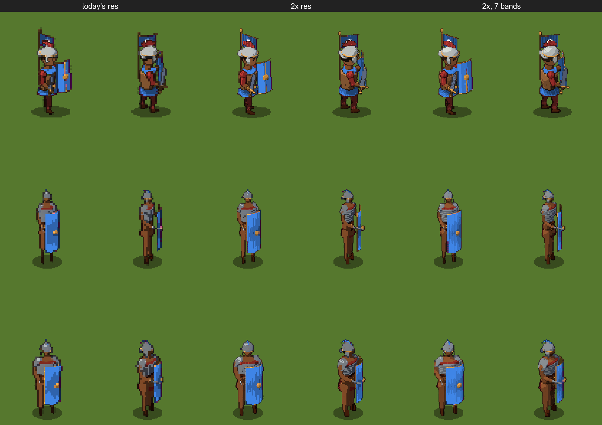
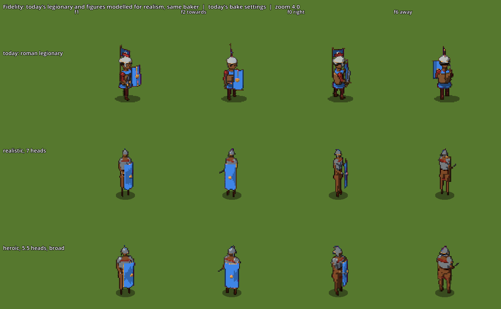
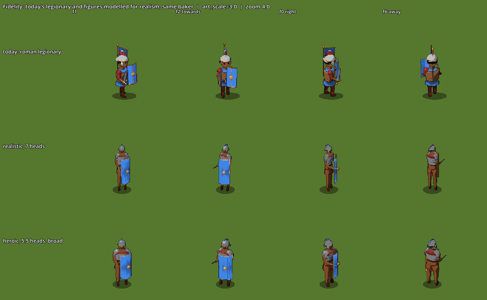
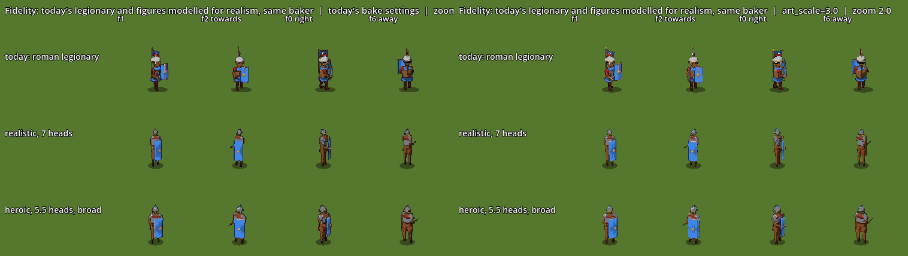
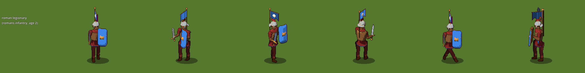
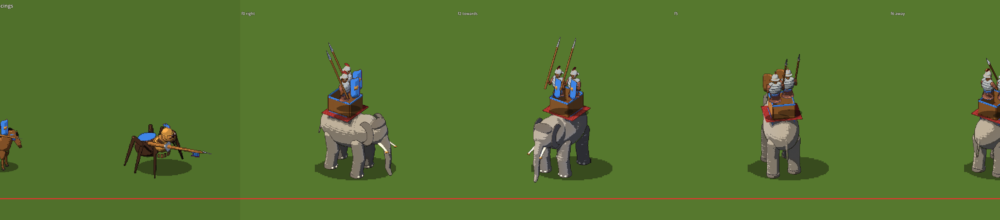
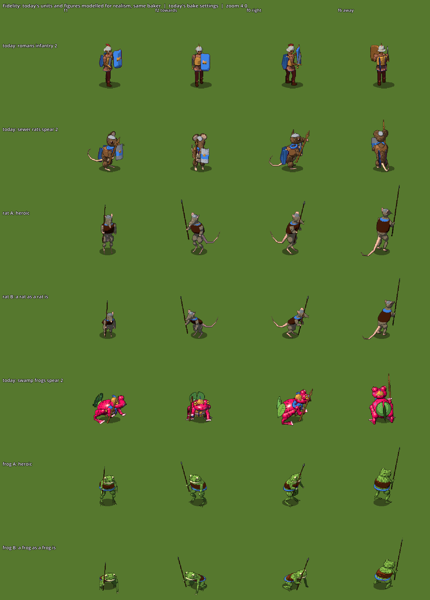

# Unit fidelity (rounds F1 and F2, 2026-10-26/27)

**F1 picked** (D-173): the heroic 5.5-head build at 2x, built in milestone 23. **F2 (rats and frogs) waiting on
Dominic**: see the end.

Dominic, 2026-10-26: "please focus on fidelity. I want to see if we can get our units looking much better
and more realistic. They are simple and cartoony atm". Earlier the same day: "unit and building fidelity is a
key goal, units being more detailed and higher quality" (study AQ1, `docs/concepts/art-quality/`).

This round asks one question first: **where does the cartoon look come from?** Then it shows what a
realistic figure looks like through our own baker. Nothing here is in the game.

## 1. It isn't the rendering

The same five units (a legionary, a Greek archer, a mounted knight, a cheesehammer rat, a frog) baked four
ways: today; smooth shading with no outline and a rim light (the pre-rendered look); twice the resolution
with six value bands; twice the resolution, smooth.



- **Smooth, pre-rendered shading makes them look more like toys, not less.** With the painted bands and
  outline gone, our models show what they are: soft primitive blobs in bright colours, a vinyl figure. The
  bands and outline are doing a lot of work hiding that.
- **2x resolution adds detail** (faces, plate edges, the horse's mane, the rat's fur) but doesn't change what
  the figure is: a 3.4-heads-tall toy soldier.
- Placement check: PASS on every row of all four.

What makes them cartoony is the **models**:
- **Proportions.** Today's human is ~3.4 heads tall (`docs/concepts/direction.md` measured it): a head as
  wide as it is tall, short legs, hands near the knees. A real man is ~7.5 heads; the genre's classic heroic
  build is ~5.5.
- **Primitive shapes.** Bodies, rats and frogs are built from spheres, capsules and cones in code; only the
  human head, torso and legs come from Blender, and they keep the toy proportions.
- **Colour.** Saturated, flat team blue on the whole tunic and shield; the genre's realistic units keep team
  colour to a smaller region (a shield face, a crest, a sash) over natural cloth, leather and iron.

Stretching today's human (longer legs, smaller head, `AOW_HUMAN_LEGS` / `AOW_HUMAN_HEAD`) is not a shortcut:
the placement check fails it (feet 5-8 units through the ground, a quiver cutting a leg), because the body's
hips, sockets and gear all assume the old build. New proportions mean a new body.

## 2. A figure modelled for realism, through our baker

`tools/blender/concept_soldier.py` models a whole legionary by script: an anatomical body (pelvis, ribcage,
shoulders, limbs as tapered tubes on their bones, knees, calves), a head with jaw, brow and nose, a red wool
tunic, segmented plate with shoulder hoops, a belt with a studded apron, nailed boots, a galea with cheek and
neck guards and a crest, a curved scutum, a gladius. Two builds: **realistic, 7 heads** and **heroic, 5.5
heads, broad**. `tests/art_quality/fidelity_sheet.gd` bakes them with the game's unit baker (same camera,
light, bands, outline, pixelizer, our materials and textures) beside today's legionary at the same size.

Close up (f1 and f0), today's resolution, 2x, and 2x with seven bands:



Four facings, today's resolution and 2x:




At play size (today's resolution left, 2x right):



What it shows:
- **The figures read as soldiers, not toys.** Proportions do most of it. The heroic build keeps the shoulders
  and weapon readable; the realistic one gets thin.
- **At today's resolution, realism costs readability.** A 7-head figure's head is about 5 art pixels; legs are
  2 pixels wide. At 2x the plate bands, helmet, crest and sword read. **Realism and 2x go together.**
- **The painted bands and outline still make it feel like the genre.** It looks like a classic RTS unit, a
  serious one.
- This model was made by script in about an hour; its limits are mine (no hands with fingers, no cloth folds
  under the plate, a simple face). A real build would take each piece further.

## Options

| | What | Feel | Cost |
|---|---|---|---|
| **A. Heroic, 5.5 heads, 2x** | new human body at the genre's heroic build, gear refitted, units baked at 2x, team colour on a smaller region | the classic RTS soldier, grown up; most readable in a crowd | a new human body + every human gear piece refitted; 2x costs (AQ1: bake ~2x on a cold start, ~2x video memory, atlas pages) |
| **B. Realistic, 7 heads, 2x** | the same at real proportions | the most realistic; thin in a big fight | as A, and it needs 2x to read |
| **C. Today's proportions, more detail** | keep the build, model the pieces better, 2x | the same toys, better made | least work; doesn't answer "realistic" |

Creatures go the same way after the human: a rat built like a rat on its hind legs rather than a mascot, a frog
with a real frog's skin and build. Each is its own concept round (creature kit, D-080).

**Recommendation: A**, the heroic build at 2x, keeping the painted bands and outline: it answers "more
realistic" and stays a classic RTS. Then humans first, in this order: the body (Blender, sockets and hips in
data), heads, the gear that fits them, then the 2x bake with atlas pages and a Steam Deck check. Each step
through `tests/placement_check.gd` before it's shown.

## How to run

```sh
blender -b --python tools/blender/concept_soldier.py -- /tmp/soldier_7.glb heads=7
blender -b --python tools/blender/concept_soldier.py -- /tmp/soldier_55.glb heads=5.5 build=1.2
[AOW_ART_SCALE=3.0] godot --path . --audio-driver Dummy --always-on-top --script res://tests/art_quality/fidelity_sheet.gd -- /tmp/f.png 4 "realistic=/tmp/soldier_7.glb" "heroic=/tmp/soldier_55.glb"
# the shading options: tests/sheets/fidelity_f1.json, once per option with its flags
AOW_ART_SCALE=3.0 AOW_UNIT_BANDS=0 AOW_UNIT_OUTLINE=0 AOW_UNIT_RIM=0.6 godot --path . --audio-driver Dummy --always-on-top --script res://tests/sheet.gd -- tests/sheets/fidelity_f1.json /tmp/f1
```

Flags (all off unless set; their bakes keep apart in the bake cache): `AOW_ART_SCALE`, `AOW_UNIT_BANDS`
(0: smooth), `AOW_UNIT_OUTLINE=0`, `AOW_UNIT_RIM=<energy>`, `AOW_HUMAN_LEGS`, `AOW_HUMAN_HEAD`.


---

## Round F2 (2026-10-27): rats and frogs at the humans' quality

Dominic, on the heroic humans in the game: "feel like we're almost there, but not 100%. The design (clothes etc) of
the humans feels cheap still. And the rats and frogs dont feel same quality". On F1's figure: "this is good", and
"rats etc should follow".

The humans got clothes and gear at the concept's standard (milestone 23 step 2b): a wool tunic in an undyed tone of
the culture's colour with folds, the team colour on a sash, the hem, shields and crests; shaped bare arms under a
short sleeve; a Blender-modelled galea (ribs, hinged cheek guards, a flared neck guard) and scutum (curved, rimmed,
a boss, wings and lightning). Banners only when a prompt asks for them. The elephant's riders stand in a walled
howdah, seen from the hips up (Dominic: "the elephant with units standing makes no sense now").




For rats and frogs, two takes each, modelled by `tools/blender/concept_creatures.py` and baked beside today's:



- **Rat A, heroic:** upright, broad in the shoulder, a long snout and big ears, digitigrade legs on long hind feet,
  a tail like a whip; a leather jerkin, a tin cap, a spear. Human-sized (D-116).
- **Rat B, a rat as a rat is:** hunched forward, the head carried low, short arms; the same kit.
- **Frog A, heroic:** upright on long folded legs, a broad chest, a wide flat head with the eyes on top; a bark
  cuirass, a team sash, a spear.
- **Frog B, a frog as a frog is:** squat on folded haunches, a forelimb planted.

What they show: the realistic animal shape (a real rat's head and tail, a frog's flat head and webbed feet) does most
of the work, as proportions did for the humans. They are quick models (an hour or so each); the colours are fixed
concept ones (grey-brown rat, green frog), not the race palettes. Building one means its body, head and legs in
Blender with the game's sockets and cut legs, its gear refitted, the frogs' hop and their 3D deaths redone, and the
placement check.

**Recommendation:** rat A and frog A, the heroic takes, to stand with the heroic humans; B's realism reads as
vermin, not soldiers. Dominic picks.
